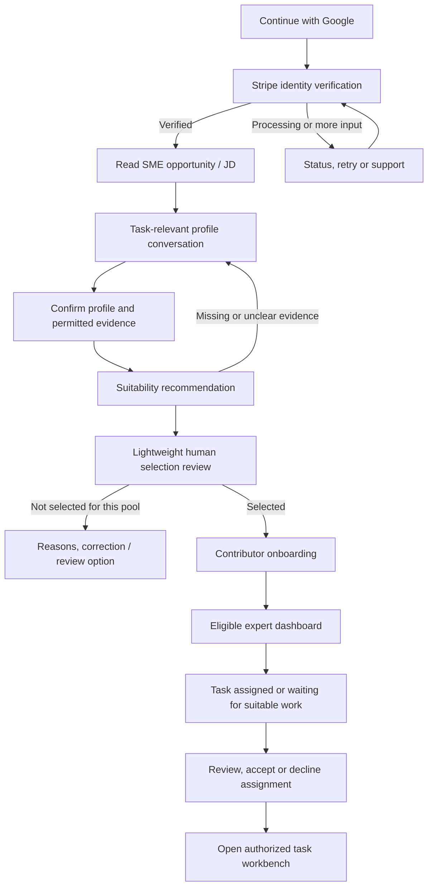

# FLOW 2 — SME candidate flow (M4)

ADI Praxis (ADI-Labs) · version 1.0 draft · 26 September 2026. Candidate registration, identity verification, conversational professional profile, task-pool suitability, onboarding and assignment handoff.

## How this fits the main spec

This tab is the detailed FLOW 2 candidate spec and is built in milestone M4. Where it and the main tab disagree on candidate sign-in, verification, profile, selection or onboarding, this tab wins.

| This tab | Main spec equivalent |
| --- | --- |
| SME opportunity / task pool (versioned brief + criteria) | The project's JD, extended with versioned eligibility criteria and question policy |
| Enrollment (user × pool) | Per-project validation; each project publishes one pool, so one enrollment per candidate per project |
| Suitability recommendation + human selection | FLOW 2 validation outcome (`APPROVED` / `REJECTED`); decided by internal Reviewers |
| Qualification scope | What the candidate may be assigned to in that project |
| Onboarding (C07) | New gate between selection and task access |
| Assignment `PROPOSED` → `ACCEPTED` → `HANDED_OFF` | Candidate accepts the project assignment, then pulls tasks from the FLOW 3 queue |
| Task workbench | FLOW 3 task execution screen |
| C03 deep link | Target of the LinkedIn campaign's tracked apply link |

Changes this makes to the main spec:

- Candidate sign-in is Google only in v1. Apple comes later through explicit account linking; LinkedIn sign-in is not in v1 (LinkedIn stays the sourcing channel).
- Identity verification (Stripe Identity) happens right after sign-in, before the profile conversation.
- The FLOW 2 "validation" stub is replaced by the conversational profile, criterion-based AI recommendation and human selection below.
- Candidate status uses the independent state dimensions in section 10, replacing the single candidate status enum.

The main spec still owns the LinkedIn campaign, talent-pool matching, task generation, the Approved Task Dataset and FLOW 4.

## 1. Product objective

Recruit and onboard credible subject-matter experts (SMEs) to create, annotate, review and validate long-horizon RL tasks. The platform must discover what an expert has actually done, which domains and task types they can support, and what evidence supports those claims, without making them complete a long generic résumé form.

The principal profile interface is a guided, multi-turn text conversation. It asks only questions necessary for the selected SME opportunity/task pool, extracts a structured profile, shows that profile for correction, and produces an explainable suitability recommendation. Selected experts complete onboarding and receive assignments matched to their approved scope.

This is **not the Interview Gym hiring pipeline**. There is no coding hackathon, scheduled interview, Calendly, Google Meet recording, personality assessment or offer-letter workflow in this scope. The original four engineering/operations job titles and JDs are not defaults for this new platform.

### 1.1 What is extracted and what changes

| Existing candidate concept | New platform requirement |
| --- | --- |
| Google/Apple candidate sign-in | Google in v1; Apple deferred, with provider-independent account design |
| Identity verification | Stripe Identity flow, kept separate from professional credentials |
| Published job/JD | SME opportunity or task-pool brief, with versioned eligibility requirements |
| Static profile, GitHub and papers | Conversational domain profile; GitHub/papers only where relevant, never universal requirements |
| AI matching | Criterion-based suitability recommendation grounded in confirmed answers and credential evidence |
| Repeated assessment/interview stages | A lightweight human confirmation/exception step, followed by onboarding |
| Employment offer | Contributor onboarding and approved task-pool membership; not an employment offer |
| Candidate dashboard | Profile/verification status, qualification scope, onboarding checklist and assigned tasks |

Source extraction: candidate login, verification, profile/versioning and access-control requirements from `adi-interview-gym/docs/interview-gym-v2/01-IMPLEMENTATION-SPEC.md` and its database/state contracts. This document is self-contained and supersedes those hiring-specific journeys **only for the new SME platform**. It does not modify the original specification or repository.

### 1.2 Critical distinctions

1. **Account authentication:** control of a Google account; not proof of work experience.
2. **Identity verification:** a verified person under the configured identity checks; not certification as an expert.
3. **Credential validation:** evidence supports a particular qualification, role or employment claim.
4. **Task suitability:** the supported experience fits a defined domain, jurisdiction, contribution role and task complexity.
5. **Selection:** an authorized person confirms enrollment into a particular task pool, based on the recommendation and evidence.

A chat answer is a claim, not independent credential verification. Neither a polished answer nor a successful Stripe check is sufficient to label someone a verified banking/compliance expert. No universal “expert score” or personality inference is needed.

### 1.3 Scope and assumptions

Included: candidate screens, required owner-side inputs, conversational logic, credential/evidence model, selection handoff, onboarding, assignment list/acceptance, persistence, access rules and acceptance criteria.

Excluded: full owner/admin portal, task-authoring workbench, simulation builder, RL training infrastructure, payment/payout collection, tax onboarding, automatic reference outreach, background checks and cloud deployment. The task workbench is a separate platform module; this specification ends when an eligible expert opens an authorized assignment there.

**JD-screen assumption:** “Upload the screen” is ambiguous. Provisionally, support a candidate-facing opportunity/JD page and a minimal owner input for a JD document. A later screenshot can define presentation; it is not executable configuration. Candidate users cannot upload or replace the qualification requirements. Do not implement a full job-management system just to support this dependency.

**Decision-design safeguard:** the requested fit/not-fit assessment is an AI-assisted recommendation, with NEEDS\_INFORMATION available. Because selection affects access to work, an authorized reviewer confirms both selection and non-selection. This adds no scheduled interview; it is a lightweight review of the same profile. Chatbot-only rejection or irreversible account exclusion is not part of v1.

## 2. End-to-end candidate journey

Public visitors may preview a published opportunity before signing in. An opportunity-specific link is preserved through login and verification. When a person starts at the general login page, the default route is verification → opportunity selection → relevant profile conversation. Identity completion gates profile submission/selection and task access; a pending verification must not lose already saved progress.

One person can qualify for several pools. Reuse confirmed facts when relevant, but keep each pool's requirements, profile snapshot, recommendation and decision separate. “Not selected for sanctions review” does not mean “not an expert” or “not eligible for every pool.”

## 3. Screens

Every screen needs accessible labels, keyboard operation, loading/empty/error states, save status, help/contact access and a clear next action. Use the ADI Praxis branding defined in the main spec (logo, palette, tokens) without requiring the old Interview Gym layout. Mobile use must be supported for login, verification, chat and evidence upload.

### C01 — Sign in

Primary action: **Continue with Google**. Show purpose, privacy/terms links and a short explanation of why identity and relevant experience will be checked. No password registration or Apple button that pretends to work. Apple is a later release.

The server validates Google credentials before issuing the platform session. Verify token signature, issuer, intended audience and expiration; use Google's stable subject identifier for the provider identity, not the email string as the sole identity key. Follow the CSRF protection appropriate to the chosen Google flow. [Google identity-token verification](https://developers.google.com/identity/gsi/web/guides/verify-google-id-token)

Platform requirements: secure server-issued session; safe same-origin return paths; logout; session expiry recovery without losing saved profile answers; rate limits; no role selector that grants administrative access. Request sign-in scopes only, not Gmail/Drive/contacts. Name/email may be offered as editable contact defaults, not expertise evidence. Do not use the profile photo for suitability.

Later Apple integration must link through an authenticated, explicit account-linking process. Do not merge accounts automatically by matching names or email strings, including private-relay addresses. No duplicate identity-verification/profile data should be created merely because a provider is added.

### C02 — Verify identity

Explain: “We verify identity to protect the contributor community. This does not verify your professional qualifications.” Show configured checks and applicable notices before entering Stripe's supported flow. Return to the platform for status and next steps.

Use Stripe Identity VerificationSessions rather than treating payment onboarding as expertise verification. Stripe document checks can include a selfie check; enable only the approved verification configuration. Session states include `requires_input`, `processing`, `verified` and `canceled`; an interrupted flow can reuse an eligible session. Keep the session secret restricted to its intended user. [Stripe VerificationSessions](https://docs.stripe.com/identity/verification-sessions)

UI: Not started; Continue verification; Processing; Verified; More information needed; Canceled; Help needed. “More information needed” offers a supported retry and help. Unsupported documents/countries, consent issues and technical failures lead to support or an approved alternative identity process, not an expertise rejection. Never label a manual alternative as “Stripe verified.” [Stripe verification outcomes](https://docs.stripe.com/identity/handle-verification-outcomes)

Server-side authenticated provider status is authoritative, not a browser success redirect. Verify webhook signatures using the original request body, `Stripe-Signature` and the endpoint secret. Persist deduplicated receipts, reconcile the correct account/session and distinguish test from live mode. [Stripe webhook verification](https://docs.stripe.com/webhooks/signature)

Store only necessary session references, check/status summary, timestamps and operational reason codes. Identity images, ID numbers, dates of birth and raw selfie data do not enter the chatbot, credential evidence bundle, suitability model or task-matching profile. Do not download them to the platform merely because an API permits access. Identity data and expertise data have separate access and retention policies.

### C03 — SME opportunity / JD

Candidate sees an understandable brief describing:

- Domain and specialty; intended jurisdiction/locale and language of work.
- Contribution role: task author, annotator, reviewer, rubric/evaluation designer or scenario validator.
- Example outputs and why they are used for long-horizon RL tasks.
- Required versus preferred experience and evidence; approved equivalence routes where applicable.
- Relevant recency, seniority/responsibility, time commitment and task complexity expectations.
- Confidentiality/conflict requirements, onboarding steps and available compensation/engagement terms if approved.
- “What we will ask” and what not to disclose, including real customer information.

Actions: **Build my SME profile**, save opportunity, return to opportunities. Closed/unpublished pools cannot accept new enrollments. Requirements are readable before the candidate commits to the conversation. No invented salary, task volume or promise of selection/work.

Owner-side dependency only: an authorized owner may upload a PDF/DOCX or enter text, inspect extracted content, define eligibility criteria/question routes and publish a version. Imported text is untrusted source material. Scanned/unreadable input requires confirmed transcription; screenshots do not silently become authoritative requirements. A later UI screenshot influences layout only. Publishing always requires a human.

The selected opportunity version is pinned when the profile is submitted. Material requirement changes must be disclosed and handled through a new review; never silently move the candidate to a different rubric.

### C04 — Conversational profile

Main view: chat; secondary view: **Your SME profile** with structured facts, completion sections and claim/evidence labels. On mobile, the summary is a separate tab. The candidate can see why a question matters, edit an answer, skip optional questions, say “I don't know” or “I cannot disclose,” save and resume, or use an equivalent accessible structured form.

The bot asks one focused question at a time. It adapts to the chosen domain and information already provided. It must not ask an AML reviewer for frontend frameworks, demand papers from every compliance expert, or assume a senior title proves hands-on responsibility. Candidate corrections update the profile version and any affected recommendation.

Suggested sections: expertise focus → relevant role history → work performed and authority → jurisdictions/task types → a short sanitized workflow explanation → supporting credentials/evidence → availability/conflicts → review and confirm.

Proposed usability target, not a compulsory test duration: typically 8–15 primary turns where the opportunity needs them. Ask fewer if existing confirmed answers cover requirements. Allow at most two clarifications for a specific unresolved fact before offering “unknown,” alternative evidence or human help. Reaching a question/time limit is not a negative suitability signal.

Do not collect voice/video, emotion, personality, appearance, religion, caste, race, family status, health history, salary history or other unrelated sensitive information. Country of work/jurisdiction and task language are collected only for legitimate task eligibility; do not infer nationality or ethnicity. Accommodation requests are separate from scoring.

### C05 — Review profile and evidence

Before submission, show an editable summary:

- Total relevant experience, specialty-specific experience and how durations were calculated.
- Roles, responsibilities, jurisdictions and contribution capabilities.
- Self-reported versus supported versus independently checked claims.
- Evidence attached, outstanding requirements, contradictions needing clarification.
- Selected task pool, criteria version, relevant policies and availability.

Buttons: **Edit with assistant**, edit individual fields, **Save draft**, **Confirm and submit**. Submitting is explicit; merely finishing a chat does not authorize a decision. The candidate confirms accuracy and permission to use uploaded materials for qualification review. Optional permission for future opportunities is separate.

### C06 — Suitability and selection status

Show respectful, task-specific explanations, not “You are unfit.” Candidate states are: submitted; more information requested; review in progress; selected for this pool; not selected for this pool; correction/review requested.

The model produces FIT\_RECOMMENDED, NOT\_FIT\_RECOMMENDED or NEEDS\_INFORMATION. These are not final account or employment decisions. While review is pending, label any visible positive indication as preliminary. Adverse reasons are candidate-facing only after human review. The reviewer can confirm selection/non-selection or request a specific clarification without scheduling an interview.

After non-selection, explain the task-related gap and allow correction/review. Distinguish a confirmed lack of required experience from an unverified claim. Suggest another pool only from actual available opportunities, without promising acceptance. A review request does not expose private reference information or internal security controls.

### C07 — Selected expert onboarding

Checklist depends on the approved contribution scope:

1. Confirm expert profile, jurisdiction, task role and approved limitations.
2. Accept current contributor/confidentiality/IP/data-use terms supplied by the owner; never invent legal terms.
3. Declare relevant employer/customer conflicts and confirm authorization to contribute original or permitted material.
4. Read concise guidance on task format, state/action definitions, dependencies, failure/recovery cases, rubrics and evidence.
5. Complete the disclosed tutorial acknowledgement; a short calibration example is optional per pool, not a surprise hackathon.
6. Confirm task language, timezone, availability and notifications.

Activation requires the versioned checklist. If a calibration is required, disclose it on C03 and do not use its output as unpaid production task content. A failed calibration means clarification/support and review, not automatic account exclusion. Payment/tax onboarding, if later required, is a separate clearly labeled dependency; this spec does not collect bank details.

### C08 — Expert home and assigned tasks

Show verified identity status, approved expertise/task roles, onboarding progress, profile updates and task cards. Selected is not the same as onboarded, and onboarded is not a guarantee of an immediate assignment. Empty state: “You are ready for matching tasks. No task is currently assigned.”

A task card contains task ID/version, title, pool/domain, jurisdiction, contribution role, expected output, approved effort/deadline, language, prerequisites, compensation terms if supplied, confidentiality level and assignment status. Do not show confidential task materials before authorization.

Actions: view brief; accept; decline with optional reason; request clarification; open workbench after acceptance. A decline is not evidence of incompetence. Acceptance rechecks selection scope, onboarding, identity eligibility, conflicts, capacity and assignment version atomically. New specialization or expiry of a required credential may require re-review before new assignments, not deletion of prior work.

Do not allow an expert to independently approve their own authored task. Author and reviewer assignments must respect separation of duties. Full task creation, submission, review and payment UIs are outside this candidate-flow specification.

## 4. Conversational profile — required data

“Required” means needed for the particular published criterion, not every field for every person. Unknown values stay unknown; never default unknown experience to zero or invent certifications/employers. Store original answer references and candidate-confirmed normalized values.

| Group | Fields | Relevance/validation |
| --- | --- | --- |
| Contact/account | Display name, contact email, preferred task language, timezone | Google name/email are confirmable defaults; timezone can be suggested and confirmed; no expertise inference |
| Domain | Primary domain, specialties, secondary specialties | Controlled taxonomy plus “describe your specialty”; no forced unrelated branch |
| Experience | Overall domain duration, specialty duration, role periods, current/recent practice | Compute from confirmed month/year intervals where available; maintain approximate/self-reported labels |
| Role history | Role title, employer type, employer name when needed, employment mode, start/end month, responsibility level | Distinguish performed, supervised, reviewed, approved and advised; a title alone is not proof |
| Work scope | Processes handled, task frequency/scale as optional ranges, decision authority, outputs personally produced | Ask only enough to establish competence; no confidential volumes/customer data |
| Jurisdiction | Countries/regulatory regimes worked under, relevant period and process | Claimed experience, not current legal authority; do not assume it transfers to all locales |
| Tools/methods | Relevant tool categories, standards or procedures used | Only when required by the task; exact proprietary systems optional unless justified |
| Credentials | Relevant certification/license, issuer, dates, status, verification method | Optional unless a published requirement; equivalent practical experience can count where allowed |
| Work example | Short generic/synthetic process, decisions, dependencies, exceptions, evidence and completion condition | Demonstrates claimed procedural knowledge; not independent proof of employment or certification |
| Contribution role | Author tasks; annotate; review; design taxonomy; define rubric/reward; validate scenarios/evals | Separate capabilities; seniority alone does not qualify someone for every role |
| Evidence | Résumé, redacted role/qualification proof, permissible public verification, reference with consent | Link to individual claims; request the least sensitive sufficient evidence |
| Availability/conflicts | Capacity range, start availability, employer restrictions, task-specific conflict declaration | Scheduling/eligibility only; not an expertise score |

### 4.1 Banking/compliance extension

Ask which work is relevant first: for example KYC/onboarding, due diligence, transaction-monitoring investigation, sanctions review, compliance testing, policy/control design, audit or regulatory reporting. These are routing examples, not a prescribed legal taxonomy or a claim that all are equivalent.

Then capture:

- Years in banking/financial services, separately from years directly doing the selected compliance work.
- Roles and periods in that work; analyst, investigator, reviewer, team lead, compliance officer, auditor, policy specialist or equivalent candidate-described role.
- What they personally investigated, prepared, checked, escalated or approved; actual responsibility, not just department membership.
- Relevant customer/product segments and jurisdictions, only at the level needed by the task pool.
- Types of evidence they evaluated, decision criteria, escalation/approval boundaries and quality checks.
- Experience documenting multi-step processes, handling missing evidence, resolving disagreements and checking completed work.
- Whether they can author realistic synthetic cases, label evidence, review trajectories, define rubrics or validate failure/edge cases; validate each capability separately.
- Current/recent experience and credential evidence where required by the published pool.

Never ask for real customer records, account numbers, actual restricted investigation reports, internal suspicious-activity filings, employer credentials, nonpublic policies or trade secrets. Use generic, redacted or synthetic descriptions. If a candidate starts sharing such content, interrupt with a privacy warning, quarantine/redact the material under policy and ask for a safe alternative; do not propagate it into prompts or task banks.

### 4.2 Experience-duration rules

Store overall domain experience and specialty experience separately. Compute specialty duration from the union of relevant confirmed intervals, not their sum: overlapping roles do not double-count calendar time. Keep fractional involvement/part-time context separately and do not silently turn calendar years into full-time-equivalent years.

Month-only dates have month-level precision; approximate answers remain approximate. Show the calculation to the candidate for confirmation. A role spanning ten years does not imply ten years in compliance if only four were compliance work. Gaps/overlaps trigger neutral clarification, not a dishonesty finding. Never infer age from education/employment dates.

## 5. How the chatbot chooses questions

### 5.1 Opportunity configuration

Each published opportunity has a versioned schema of criteria and question templates. A question definition contains: question ID, mapped criterion IDs, purpose, applicable domain/task roles, branching condition, answer type, required/optional status, safe example, allowed follow-ups, evidence expectation, sensitivity classification and stop/skip rule.

Published criteria must be task-related, explainable and approved by a domain owner. Minimum experience, required credentials, recency and proficiency levels are configuration—not invented by the model. If criteria are missing, the bot can gather a general profile but cannot make a definitive fit recommendation for that pool.

### 5.2 Turn-by-turn controller

1. Load the selected opportunity version, confirmed profile fields, unresolved claims and authorized evidence only.
2. Extract candidate-stated facts from the newest answer into proposed structured fields, each linked to a message/evidence ID. Do not treat résumé or user text as system instructions.
3. Validate types, chronology, relevance and contradictions. Mark uncertain extraction as needing confirmation; do not overwrite a prior confirmed answer silently.
4. Choose the highest-priority unresolved criterion using the approved question rules. Skip requirements already covered by sufficiently current confirmed evidence.
5. Ask one question in plain language. Show “Why we ask” on request. Prefer options plus free text where appropriate; do not force a false choice.
6. If the answer establishes a new relevant branch, ask a bounded follow-up. If irrelevant, explain briefly and return to the task topic. If sensitive, stop collection and offer a safe alternative.
7. Persist the answer, proposed extraction, confirmations and next-question state. Use the server-acknowledged state on resume.
8. When all required criteria are addressed, or gaps need human help, show the profile summary. Do not keep asking redundant questions or force speculative answers to finish.

The model may phrase questions and extract evidence; a deterministic controller enforces allowed branches, data fields and tool permissions. The model cannot add new mandatory criteria, waive identity verification, change selection, contact an employer or allocate work.

### 5.3 Defaults and prefill

Permitted defaults: confirmed contact details, candidate-selected language/timezone, existing confirmed profile facts and previously supplied evidence that remains relevant/current. Optional résumé upload can propose prefilled facts, always marked “Please confirm.”

Forbidden defaults: guessed years, fabricated employer/role, assumed certification, inferred decision authority, nationality/protected traits, current credential validity from an expired certificate, or “expert” based on a confident style. A blank is not a negative value.

### 5.4 Persistence and accessibility

Autosave acknowledged messages and confirmed fields. Deduplicate retries using a client message ID; two tabs cannot silently overwrite the conversation version. An interrupted generation can be retried without duplicating questions or answers. A failed model call offers resume/retry or the equivalent form and does not affect suitability.

Editing an earlier answer recalculates dependent fields and invalidates stale recommendations. On a second pool, ask only its incremental requirements. Keep the relevant profile snapshot immutable after submission while allowing a new amendment/version.

## 6. Worked banking/compliance conversation

Illustrative conversation only. No real candidate or approved selection threshold is represented. Opportunity: an SME contributor pool for authoring and reviewing synthetic compliance-investigation tasks.

| Turn | Bot question or confirmation | Illustrative answer / captured meaning |
| --- | --- | --- |
| 1 | Which compliance processes have you personally worked on? | “KYC and enhanced due diligence.” Capture specialties; skip unrelated engineering questions |
| 2 | How much experience do you have in banking overall, and specifically in those processes? | “12 years in banking, 8 in KYC/EDD.” Capture two self-reported durations; do not call either verified |
| 3 | Which roles made up those eight years? Please give approximate start/end months and your responsibilities. | Candidate supplies role periods; create a timeline; ask only about ambiguous periods |
| 4 | In your most relevant role, did you prepare cases, review others' work, approve outcomes or advise the team? | “Prepared cases, later reviewed analysts' work; final approval belonged to a manager.” Preserve authority boundary |
| 5 | Which jurisdictions and customer/product types were relevant to that work? | Capture the candidate's stated scope, not global compliance eligibility |
| 6 | Without sharing customer or confidential information, describe a case workflow from its trigger to completion. | Capture evidence gathering, dependent decisions, escalation and verified completion |
| 7 | You mentioned missing evidence. What would happen next, and how would a reviewer check that step? | One targeted depth question grounded in the preceding answer; capture exception/recovery and reviewability |
| 8 | Have you written procedures/training cases, labeled evidence or reviewed case quality? Which would you want to contribute here? | Candidate chooses task author and reviewer; bot records support for each separately |
| 9 | What permitted evidence could support your relevant roles or credentials? | Offer redacted proof, public credential verification or a consented reference; “none available” remains a review issue |
| 10 | What capacity can you offer, and are there restrictions on using employer or client material? | Availability and conflicts; no demand to disclose employer secrets |
| 11 | Here is the profile I captured. Is it accurate, and do you want to submit it for this pool? | Candidate edits/approves; only explicit submission starts suitability evaluation |

If Turn 1 instead describes policy audit without investigation work, the follow-up branch must change. If the person already answered Turns 3–5 in one message, confirm the extracted facts instead of repeating every question. No bot-authored hypothetical answer is credited to the candidate.

## 7. Professional-credential validation

### 7.1 Evidence levels

| Label | Meaning | What it does not mean |
| --- | --- | --- |
| SELF\_REPORTED | Candidate states a claim | No independent validation |
| DOCUMENT\_SUPPORTED | Permitted document appears to support a specified claim after review | Document authenticity/employment history not necessarily independently confirmed |
| INDEPENDENTLY\_VERIFIED | Authorized verifier checked the particular claim against an authoritative source or permitted confirmation | Not blanket verification of every claim or every jurisdiction |
| INCONCLUSIVE | Evidence is unavailable, ambiguous or insufficient | Not proof of falsehood |
| CONTRADICTED | Material inconsistency has evidence and needs resolution | Not an automatic accusation or final rejection |
| EXPIRED | Previously relevant time-limited credential is no longer current | Does not erase all practical experience |

Each claim stores the text/structured value, evidence references, verification method, reviewer/provider, checked date, scope, expiry if applicable and candidate corrections. Badges are scoped: “Identity verified,” “Role evidence reviewed,” or “Certification X checked on date Y,” not a misleading generic “Verified expert.”

### 7.2 Minimal evidence workflow

Ask for evidence only for important eligibility claims or unresolved contradictions, not every sentence. Accept suitable redacted documents or equivalent evidence routes approved for the pool. Do not demand confidential records, full payslips, government IDs in the chat, credentials/passwords, or references without consent.

Public verification is limited to candidate-provided or approved authoritative sources, with appropriate access rights. Do not scrape private LinkedIn data or contact an employer automatically. Reference outreach is outside v1; capture consent and a pending review if needed. Documentary OCR/extraction can assist a reviewer but cannot certify authenticity.

For expertise not established by credentials alone, the short conversation can provide evidence of procedural understanding. Keep this separate from verification of employment and from later contribution-quality calibration. Clear writing style is not a proxy for domain competence; support the task language and accessible alternatives.

## 8. Suitability recommendation and selection rules

### 8.1 Criterion-based, pool-specific result

Compare the confirmed profile/evidence against the pinned published criteria. For each criterion record: MET, PARTIALLY\_MET, NOT\_MET or UNKNOWN, relevant answer/evidence IDs, limitations and a short rationale. Required versus preferred criteria are distinct. No default percentage threshold or invented weighting is supplied by this specification.

Suggested recommendation rules:

- **FIT\_RECOMMENDED:** required criteria appear met, required claim-verification levels are satisfied and no unresolved material contradiction blocks assessment. This is a recommendation, not selection.
- **NEEDS\_INFORMATION:** a required fact or evidence is missing, conflicting, expired or too uncertain to interpret; return the smallest specific clarification request.
- **NOT\_FIT\_RECOMMENDED:** available supported information demonstrates a task-related required criterion is not met. A preferred-skill gap alone cannot trigger this result.

Identity verification pending, system outages and lack of current tasks are operational conditions, not expertise failures. A published task criterion can require a specific verified credential; absence of evidence gives UNKNOWN/clarification rather than a fabricated credential or automatic adverse action.

### 8.2 Human confirmation and candidate communication

An authorized reviewer sees the criterion table, scope, evidence levels and unresolved issues. They confirm SELECTED, NOT\_SELECTED or NEEDS\_INFORMATION with a task-related reason. No full interview or challenge is introduced. The review controls can initially be a minimal internal surface; building a general admin suite is not in scope.

Selection creates scoped qualification: for example a particular domain/specialty, jurisdiction, task complexity and contribution role, with optional expiry/review date. “Task author” approval does not automatically authorize final quality review or access to unrelated regulated data.

Candidate-facing decision includes selected scope or a concise approved gap, what can be corrected, and how to request review. Preserve versioned recommendations/decisions; a new profile version supersedes, not rewrites, previous evidence. No silent retrospective change to the candidate's approved profile.

### 8.3 Model boundary

Input: selected opportunity criteria, candidate-confirmed role/experience facts, task-relevant conversation excerpts, credential claim statuses and authorized evidence summaries. Exclude identity images, age/DOB, photo, unrelated personal data and other candidates' records.

Output: criterion findings, recommendation, evidence citations, unresolved questions and proposed contribution scope. Validate structured output before storage; unsupported citations or invented criteria cause a recoverable evaluation failure. The model has no selection, onboarding-activation, credential-verification or task-assignment write authority. Store concise evidence-backed rationale, not hidden reasoning traces.

## 9. Task assignment eligibility and handoff

A contributor may be matched only when the following are current: account enabled; identity eligibility confirmed; selected for the relevant pool/scope; required credentials current; onboarding complete; task-specific permissions/terms satisfied; conflicts resolved; available capacity.

Match by domain, specialty, jurisdiction, language, contribution role, required complexity and declared availability. Do not match using age, name, ethnicity, appearance or unrelated school/employer prestige. Do not infer willingness to take all tasks from selection.

An assignment proposal refers to an exact task and requirements version. If requirements materially change before acceptance, require renewed confirmation and eligibility checks. Reserve capacity transactionally; concurrent proposals cannot silently overbook an expert. Candidate withdrawal, revoked access or new conflict cancels pending proposals and creates a review task for accepted work rather than deleting their submitted material.

Store a qualification snapshot on assignment so downstream task quality can be traced to the expertise that justified it. Only share the minimum required qualification labels with task coordinators/customers; do not expose identity documents, private references or full chat transcripts to frontier-lab buyers by default.

## 10. Persistent states and transition rules

Keep independent state dimensions instead of one enormous hiring-status enum.

| Dimension | States | Main authority |
| --- | --- | --- |
| Account | ACTIVE, SUSPENDED, CLOSED | Authentication/account service and authorized operator |
| Identity | NOT\_STARTED, REQUIRES\_INPUT, PROCESSING, VERIFIED, CANCELED, MANUAL\_REVIEW\_REQUIRED, ALTERNATIVE\_VERIFIED | Verified Stripe results for provider states; separately authorized evidence for alternatives |
| Profile conversation | NOT\_STARTED, IN\_PROGRESS, READY\_TO\_CONFIRM, SUBMITTED, AMENDMENT\_PENDING | Candidate actions plus validated conversation controller |
| Suitability recommendation | NOT\_RUN, EVALUATING, FIT\_RECOMMENDED, NOT\_FIT\_RECOMMENDED, NEEDS\_INFORMATION, ERROR, SUPERSEDED | Bounded evaluator; no final selection authority |
| Pool enrollment | DRAFT, SUBMITTED, NEEDS\_INFORMATION, REVIEW\_PENDING, SELECTED, NOT\_SELECTED, REVIEW\_REQUESTED, WITHDRAWN | Candidate submission/withdrawal; human selection/review |
| Onboarding | NOT\_STARTED, IN\_PROGRESS, COMPLETE, BLOCKED | Checklist service under approved configuration |
| Assignment | PROPOSED, ACCEPTED, DECLINED, EXPIRED, CANCELED, HANDED\_OFF | Authorized matching/assignment service plus candidate acceptance |

Key transitions:

- New enrollment DRAFT → SUBMITTED only after an explicit candidate confirmation of current profile/criteria, required notices and identity eligibility. Create evaluator job in the same transaction.
- Evaluator needs a fact → enrollment NEEDS\_INFORMATION; ask only the missing relevant question. Candidate amendment/resubmission returns to SUBMITTED with a new immutable profile revision.
- Valid completed recommendation → REVIEW\_PENDING. Evaluation ERROR leaves a recoverable pending status; no selection or rejection is synthesized.
- Human reviewer changes REVIEW\_PENDING → SELECTED, NOT\_SELECTED or NEEDS\_INFORMATION with reasons and current evidence references.
- Candidate requests review of NOT\_SELECTED → REVIEW\_REQUESTED; authorized reviewer reopens into NEEDS\_INFORMATION/REVIEW\_PENDING, preserving previous decision history.
- SELECTED permits onboarding. Onboarding COMPLETE plus all current eligibility gates permits an assignment proposal; selection alone does not.
- Candidate acceptance changes PROPOSED → ACCEPTED; authorized workbench handoff changes ACCEPTED → HANDED\_OFF. DECLINED/EXPIRED/CANCELED proposals do not create task access.
- Enrollment withdrawal stops future assignments and cancels pending proposals. Existing accepted work follows a documented handback process; do not erase evidence/history.

All state-changing commands require authenticated actor/object scope, expected revision, idempotency and an audit event. Late model results, stale profile versions and old verification sessions cannot reverse a withdrawal or overwrite newer decisions. Use durable jobs with bounded retries; do not keep the conversation or selection state only in memory.

## 11. Minimum data contracts

This is a new platform specification, not an instruction to copy the old database wholesale. Names below describe domain records; use the target platform's established conventions when implementing.

| Record | Essential contents and invariant |
| --- | --- |
| User / provider identity | Stable internal user ID; unique(provider, subject); contact defaults; secure session references; no email-only cross-provider merge |
| Identity attempt | User, provider session ID, live/test flag, current result, checked time, operational error; separate alternative-check record and reviewer |
| Opportunity version | Pool ID, published version, JD/brief, approved criteria, question policy, domain/task-role scope, owner, terms references |
| Enrollment | User + pool, pinned opportunity version, profile version, enrollment status/revision; one active enrollment per user/pool |
| Conversation session/turn | User, pool, message ID/sequence, speaker, content, question ID, acknowledged time, schema/model/policy versions; idempotent replay |
| Profile version | Confirmed structured values, precision/unknown flags, source-turn/evidence links, content hash; immutable when submitted |
| Experience episode | Dates/precision, domain/specialty, role, responsibility, employer scope, contribution mode; duration union calculated transparently |
| Credential claim | Claim type/value, issuer/scope/dates if relevant, evidence level, method, checker, check/expiry dates and disputed status |
| Evidence artifact | Owner, private storage key, hash/type/size, linked claims, permission/redaction/scan status, retention category; no public access |
| Suitability assessment | Exact input/rule/model versions, criterion findings/citations, recommendation, limitations and supersession; no fabricated confidence probability |
| Selection decision | Authorized reviewer, scoped outcome/reasons, profile and assessment refs, approved criteria, timestamp; append-only |
| Qualification scope | Pool/domain/specialty/jurisdiction/language/contribution roles, conditions/expiry, decision reference |
| Onboarding checklist | Versioned required items, acknowledgements and terms hashes, completion/block reason; no automatic acceptance of new material terms |
| Assignment | Task/version, expert, qualification snapshot, scope/capacity/deadline/terms, status/revision and workbench reference |
| Consent / audit / jobs | Purpose-specific permissions; immutable event history; durable jobs/webhook dedupe and safe retries |

Use UTC timestamps with explicit display timezone, private artifact storage, scoped server authorization and unique constraints for repeated submissions/messages/provider events. Updating a profile must not rewrite a prior selection/assignment's evidence. Keep sensitive identity data out of common profile JSON and search indexes.

## 12. Candidate API surface (design contract, no code)

Paths are illustrative and can follow the new platform's routing conventions. All candidate mutations derive user identity from the session; never trust a request-body user ID or selection flag.

| Operation | Purpose |
| --- | --- |
| `POST /auth/google` | Validate chosen Google sign-in flow and establish session |
| `GET /me`; `POST /auth/logout` | Safe account/progress summary; revoke session |
| `POST /me/identity/session`; `GET /me/identity` | Create/resume authorized identity flow; read server-confirmed status |
| `POST /integrations/stripe/identity-webhook` | Signature-verified, deduplicated provider intake; no ordinary browser authority |
| `GET /opportunities`; `GET /opportunities/{id}` | Published candidate-safe briefs and requirements |
| `POST /me/enrollments`; `GET /me/enrollments/{id}` | Start/reuse a pool draft; view owned enrollment and next action |
| `POST /me/enrollments/{id}/conversation/messages` | Persist candidate message, validate extraction and return next relevant question/status |
| `GET /me/enrollments/{id}/conversation`; `GET /me/profile` | Resume conversation and see confirmed/proposed structured fields |
| `POST /me/profile/corrections` | Confirm/edit fields with source/version tracking; invalidate stale assessment |
| `POST /me/evidence`; `DELETE /me/evidence/{id}` | Safe owned upload and policy-aware removal request; retained evidence references handled explicitly |
| `POST /me/enrollments/{id}/submit` | Freeze inputs and queue suitability assessment, not automatic selection |
| `POST /me/enrollments/{id}/review-request`; `POST /me/enrollments/{id}/withdraw` | Correction/reconsideration or withdrawal with durable effects |
| `GET /me/onboarding`; `POST /me/onboarding/acknowledgements` | Versioned checklist and explicit item completion |
| `GET /me/assignments`; `GET /me/assignments/{id}` | Assigned-task list and permitted brief |
| `POST /me/assignments/{id}/accept`; `POST /me/assignments/{id}/decline` | Recheck eligibility/capacity and record candidate choice |
| `POST /me/assignments/{id}/open-workbench` | Short-lived authorized handoff to the separate task workbench |

Minimal owner dependencies, not a full owner UI spec: opportunity/JD import and publish; criterion/question-policy approval; claim verification; scoped selection decision; onboarding configuration; assignment creation. None is reachable with candidate permissions or writable by chatbot output.

Private uploads are streamed with size/type limits, sanitized names and malware/parser protections; approved PDF/DOCX credential evidence defaults must be set by the product owner. Do not fetch arbitrary candidate URLs without safe-fetch controls against internal/metadata addresses and unsafe redirects. Standard error handling must distinguish stale revision, unauthorized object, incomplete criterion and transient provider failure.

## 13. Privacy, reliability and non-functional requirements

- Candidate answers/files are untrusted inputs. Embedded instructions cannot change criteria, request secrets, access another profile or grant eligibility. No candidate-supplied code execution is needed for this flow.
- Keep original personal data within the qualification purpose. Do not use identity materials, professional documents or chat transcripts as RL training/task-bank content by default. Collect separately authorized, synthetic/permitted task submissions after onboarding.
- Retention, credential-source use, identity-check configuration, optional biometric checks, contributor terms and cross-border/provider processing need approved policies before real-candidate release. This specification does not certify legal compliance or specify a universal retention period.
- Provide correction, access and deletion-request routes, with documented retention/hold decisions and propagation to providers/derived data where required. Do not promise immediate erasure of every legally retained record.
- Use privacy-preserving logs: IDs/status/error codes, not raw credentials, identity secrets, confidential evidence or full chat transcripts. Restrict reviewers to assigned pools and claims. Audit access and human decisions.
- Expose the same candidate functionality through an accessible form fallback. Do not penalize use of assistance/accommodations, slower typing, concise answers, accents or non-native writing style unrelated to task requirements.
- Persist profile progress before acknowledging saves. Separate slow model/provider calls from durable submission. Show delayed/failed states honestly; retries cannot duplicate messages, enrollments or assignments.
- Local development uses explicit synthetic data and mock/provider test modes. Never display a test-mode identity as live verified. No live data or external messages are authorized by this document.
- The platform may retain a provider-neutral architecture and configurable storage for later AWS/GCP hosting; installation, deployment and implementation steps are intentionally not included in this specification-only deliverable.

## 14. Acceptance criteria

| ID | Scenario | Expected result |
| --- | --- | --- |
| CF-01 | New Google sign-in | Valid server session and correct next step; invalid token/audience/CSRF rejected |
| CF-02 | Apple not implemented | No working-looking Apple login; provider model permits later explicit account linking |
| CF-03 | Deep link to a pool through login/verification | Correct pool restored; unsafe external return URL rejected |
| CF-04 | Stripe browser redirect claims success | Not accepted as proof; provider-authoritative status required |
| CF-05 | Duplicate/out-of-order/test webhook | Verified/deduplicated/reconciled; test cannot confer live eligibility |
| CF-06 | Stripe requires input, fails operationally or is unsupported | Retry/support/approved alternative; no expertise rejection or lost profile |
| CF-07 | Read/upload JD | Candidate reads published version; only owner can import/edit/publish; unreadable extraction needs confirmation |
| CF-08 | Banking SME starts profile | Ask relevant work/roles/years/specialties; no universal GitHub/paper questions |
| CF-09 | Broad answer already supplies several fields | Propose confirmation; do not repeat already answered questions |
| CF-10 | Role periods overlap or mix noncompliance duties | Union-of-relevant-period calculation; separate total vs specialty years; uncertainty shown |
| CF-11 | Required fact missing or candidate cannot disclose | Unknown/alternative evidence/help; no invented default or automatic zero |
| CF-12 | Optional answer skipped | Continue without penalty; required gaps explained transparently |
| CF-13 | Candidate shares real customer or restricted employer data | Stop unsafe collection; protect/redact/quarantine under policy; ask for synthetic/general description |
| CF-14 | Prompt injection in chat/JD/upload | No criterion changes, secret access, selection or assignment action |
| CF-15 | Refresh, two tabs, message retry or model outage | Resume acknowledged state; dedupe and version conflict handling; no suitability penalty |
| CF-16 | Resume implies qualification but no verification | SELF\_REPORTED/DOCUMENT\_SUPPORTED as appropriate; no false verified badge |
| CF-17 | Valid identity but unverified required experience | Identity remains distinct; suitability asks for evidence or human review |
| CF-18 | Candidate confirms/submits | Frozen profile/criteria/evidence and one assessment job; saving alone does not submit |
| CF-19 | AI outputs positive or adverse recommendation | No final selection/non-selection until authorized human review |
| CF-20 | Wrong/invented criterion or invalid evidence citation | Report validation failure; no decision based on it |
| CF-21 | Candidate corrects information during evaluation | Stale result cannot overwrite newer revision; rerun/review with clear history |
| CF-22 | Not selected for one task pool | Task-specific reasons/correction route; no global expert blacklist |
| CF-23 | Selected but onboarding incomplete | Tasks cannot be accepted/opened yet; checklist explains outstanding items |
| CF-24 | All gates complete but no available task | Honest waiting state; no fake assignment or work/income promise |
| CF-25 | Assigned wrong jurisdiction/role or expired prerequisite | Server blocks acceptance; coordinator review; no access to protected materials |
| CF-26 | Duplicate accepts or concurrent capacity reservations | One valid acceptance/capacity update; conflict shown safely |
| CF-27 | Expert assigned to approve their own authored task | Separation-of-duties rule blocks independent self-approval |
| CF-28 | Candidate changes another user's object ID | Server denies profile/evidence/assignment access without leaking private data |
| CF-29 | Candidate requests reconsideration/withdraws | Versioned review or withdrawal; pending assignments stopped; prior records handled by policy |
| CF-30 | Keyboard/form fallback, short answers or accommodation | Equivalent relevant criteria and accessible completion; no style/accommodation penalty |

## 15. Decisions needed before real launch

The screens and contracts above can be built against synthetic fixtures without waiting for every business decision. Real selection/task access remains gated by the following inputs:

- [ ] First published SME opportunity/JD and whether the planned upload is a JD document, a design screenshot or both.
- [ ] Approved banking/compliance taxonomy, task roles, required/preferred criteria and acceptable credential evidence/equivalences. No minimum years or named certification has been assumed.
- [ ] Named reviewer/owner for credential checks and quick selection confirmation; review response expectations.
- [ ] Stripe account/region capabilities, verification checks and approved alternative identity process; Google configuration; Apple remains later.
- [ ] Contributor/privacy/identity/data-use notices, retention, conflict policy and terms versions.
- [ ] Onboarding materials, optional calibration policy, task-workbench handoff contract and actual assignment terms/capacity rules.

No code, migrations, provider changes, candidate decisions, emails, cloud resources or task assignments are created by this specification.
