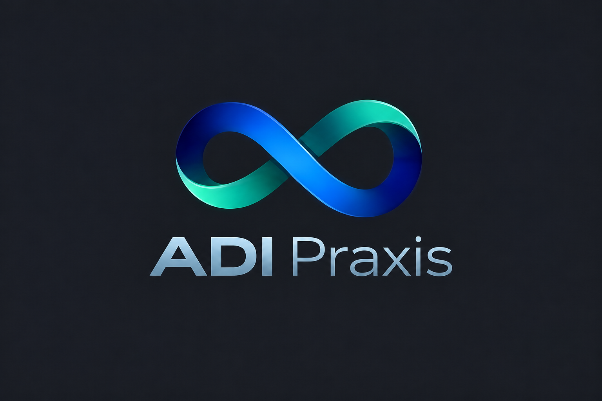
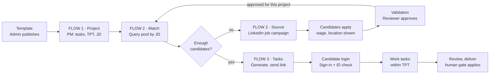
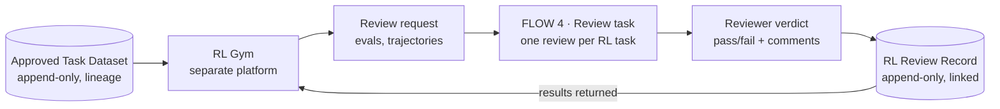
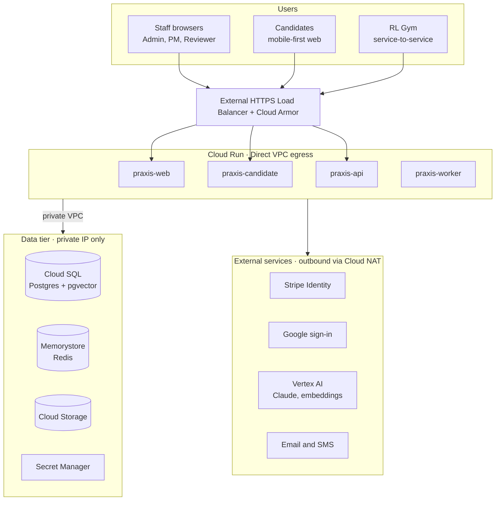

# ADI Praxis — Software Specification

Sep 26, 2026 · @Vasudevan Sundarababu

## Overview

ADI Praxis, by ADI-Labs, lets a Program Manager turn a domain workflow (e.g. Banking / KYC onboarding) into a diverse set of expert-authored tasks: many vetted experts, each writing a different case, together covering the workflow's scenarios and edge cases. It chains three flows, each built and shipped as its own module.

| Flow | Name | Trigger | Output |
| --- | --- | --- | --- |
| FLOW 1 | Project creation | PM creates a project from an admin template | Project in `READY_FOR_STAFFING` |
| FLOW 2 | Resource assignment & sourcing | Project ready for staffing | Validated candidates assigned to the project |
| FLOW 3 | Task generation & execution | Assigned candidate available | Task instances created, invite link sent, candidate completes tasks after login |
| Dataset | Approved Task Dataset | Reviewer accepts a task | Immutable record with lineage, the RL Gym base table |
| FLOW 4 | RL Gym result review | RL Gym sends a review request | Reviewer verdict and failure comments returned to RL Gym |

In scope for v1: admin template catalog, FLOW 1 end to end, FLOW 2 matching + LinkedIn job campaign + validation hand-off, FLOW 3 task creation, invite and candidate login.

Out of v1: worker payout. Wages are per task, and the platform records accepted tasks per worker so payout (e.g. Stripe Connect) can be added later. v1 serves a single client, with the schema ready for multi-tenancy.

Detailed specs live in their own tabs: FLOW 2 — SME candidate flow (M4) (`docs/FLOW2-SME.md`) (candidate sign-in, verification, profile, selection, onboarding) and Task definition — KYC (draft) (`docs/TASK-KYC.md`) (what an expert-authored task contains, the author workbench and review). Still to come: task definitions for workflows other than KYC onboarding, and the RL Gym platform. Where this spec references them it defines only the interface (inputs, outputs, status changes) so Claude Code can stub them.

## Branding

The product is **ADI Praxis**, by ADI-Labs, with the tagline "Intelligence Beyond Boundaries". Every app (admin/PM/reviewer console, candidate app, author workbench) and every email uses this identity.



**Colour palette** (sampled from the logo)

| Token | Hex | Use |
| --- | --- | --- |
| `brand-navy` | #0A2170 | Primary text on light backgrounds, headers, primary buttons |
| `brand-blue` | #2A80D0 | Links, focus rings, active states, charts |
| `brand-teal` | #3FAC95 | Success, accents, highlights, the end of the brand gradient |
| `brand-silver` | #8597A3 | Secondary text, borders, the wordmark on dark |
| `brand-charcoal` | #212227 | Dark-theme background, sign-in and landing screens |
| `brand-gradient` | #0A2170 → #2A80D0 → #3FAC95 | Hero areas, the progress rail, empty states; never behind body text |

**Rules**

- Logo placement: full logo (mark, wordmark, tagline) on sign-in (C01), public opportunity pages (C03) and email headers; the infinity mark plus "ADI Praxis" in each app's top navigation; mark only for favicon, app icon and small sizes.
- Both light and dark themes; the candidate sign-in and landing screens default to dark to match the logo. Status colours for warnings and errors stay standard and distinct from the brand teal.
- Text meets WCAG AA contrast in both themes; teal and blue are not used for body text on light backgrounds.
- Implement as design tokens in `packages/shared/theme` (CSS variables + Tailwind theme) so all apps share them; logo files live in `packages/shared/brand/`.
- Page titles read "\<Screen> · ADI Praxis"; the candidate app's install name is "ADI Praxis".

Brand assets needed before launch: the logo as SVG, a transparent-background PNG of the full logo and of the mark alone, and the wordmark font name. Until then, Claude Code uses the supplied PNG and crops the mark for the favicon.

## Personas and roles

Four roles, enforced with role-based access control (RBAC). One user may hold more than one internal role; candidates are a separate user type.

| Role | Who | Can do | Surface |
| --- | --- | --- | --- |
| Admin | Platform operator | Create, version and retire Domain/Workflow templates; manage demographic taxonomy, wage bands, users and roles | Web admin console |
| Program / Project Manager (PM) | Client or internal program owner | Create projects from templates; set task count, TPT, demographics, JD; trigger resource assignment; monitor progress | Web console |
| Reviewer / Validator | Internal ops | Validate applicants (FLOW 2), review task output where the template defines a human gate, review RL evals and trajectories (FLOW 4) | Web console |
| Candidate / Gig Worker | External worker | Apply to jobs, sign in, verify identity, accept and complete tasks | Mobile-first web and native app |

The template's "Human gate" column (e.g. "MLRO decides filing") marks decisions a gig worker never makes; the system routes those to internal Reviewers, who make the decision.

## End-to-end lifecycle and status model

Every project follows one path: template → project → staffing → tasks. Staffing checks the internal talent pool before spending on LinkedIn sourcing.



Every candidate, from the pool or from LinkedIn, passes validation for this project before assignment; the project stays in staffing until enough are approved.

**Project status**

| Status | Entered when | Next |
| --- | --- | --- |
| `DRAFT` | PM saves an incomplete project | `READY_FOR_STAFFING`, `CANCELLED` |
| `READY_FOR_STAFFING` | PM submits a valid project (FLOW 1) | `STAFFING`, `CANCELLED` |
| `STAFFING` | Resource assignment starts (FLOW 2) | `STAFFED`, `CANCELLED` |
| `STAFFED` | Assigned headcount ≥ required headcount | `IN_PROGRESS` |
| `IN_PROGRESS` | First task instance is issued (FLOW 3) | `COMPLETED`, `PAUSED` |
| `PAUSED` | PM pauses | `IN_PROGRESS`, `CANCELLED` |
| `COMPLETED` | Distinct-task target and required coverage met | terminal |
| `CANCELLED` | PM or Admin cancels | terminal |

**Candidate status (per project)**

Candidate status uses independent dimensions (account, identity, profile conversation, suitability, pool enrollment, onboarding, assignment), defined in section 10 of FLOW 2 — SME candidate flow (M4) (`docs/FLOW2-SME.md`).

**Task instance status**

`CREATED` → `ASSIGNED` → `IN_PROGRESS` → `SUBMITTED` → `ACCEPTED` or `REWORK` (back to `IN_PROGRESS`). TPT never expires a task; a PM can reclaim a stalled task, which returns it to `CREATED`.

## Admin: template catalog

Templates are a two-level catalog, Domain → Workflow, and each published Workflow is the only thing a PM can build a project from. Seed it from Taskflow.xlsx (sheet "Task Templates").

**Seed catalog**

| Domain | Workflows in the sheet | Detail in sheet |
| --- | --- | --- |
| Banking | 24, from KYC onboarding and refresh through Country-specific interpretation | Primary work, Verification/reward, Human gate |
| Healthcare | Patient Doctor Agent | Name only |
| Marketing | SEO, Branding, Shopping Assistant, Voice Shopping Assistant | Name only |
| Research Assistant | Finance, Legal, Marketing, M & A | Name only |

Claude Code should write a seed script that imports every row, keeping the three Banking description columns verbatim. Name-only workflows are created with status `DRAFT` until an Admin completes them.

**Template fields**

| Field | Type | Notes |
| --- | --- | --- |
| `domain` | FK → Domain | e.g. Banking |
| `workflow_name` | string | e.g. KYC onboarding and refresh |
| `primary_work` | text | From sheet column "Primary agent work" |
| `verification_criteria` | text | From "Verification / reward"; drives QA scoring later |
| `human_gate` | text | From "Human gate"; decisions workers must not make |
| `task_definition_schema` | JSON Schema | Inputs a task instance carries. Defined in the separate template spec; v1 stores it opaque |
| `collection_schema` | JSON Schema | Output the worker submits. Same: opaque in v1 |
| `default_tpt_minutes` | int | Suggested TPT the PM may override |
| `default_jd_id` | FK → JobDescription, nullable | Pre-fills FLOW 1 |
| `skills` | string\[\] | Used for JD matching |
| `version` | int | Immutable once a project uses it |
| `status` | enum | `DRAFT`, `PUBLISHED`, `RETIRED` |

Diversity fields on Template: `task_modes` allowed (`AUTHORING`, `ANNOTATION`), `coverage_dimensions` (json: dimension → allowed values, required cells and quotas), `edge_case_catalog` (json: name, description, quota, required flag), `default_distinct_target` (50), `default_max_per_expert` (4), `open_slot_share` (0.2), `similarity_threshold` (0.90).

**Rules**

- Only `PUBLISHED` templates appear in FLOW 1.
- Editing a published template creates a new version; existing projects keep the version they were created with.
- Retiring a template hides it from new projects but never breaks running ones.
- The task definition and collection workflow per template is a separate spec. Build it behind an interface: `validateTaskInput(template, data)` and `validateSubmission(template, data)` that return pass by default.

## FLOW 1: Project creation

A PM creates a project in one wizard: pick a template, name it, set volume, diversity target and TPT, choose worker demographics and a JD, then submit to `READY_FOR_STAFFING`.

**Wizard steps**

1. **Template** — choose Domain, then Workflow (published only). Show `primary_work`, `verification_criteria`, `human_gate` read-only.
2. **Basics** — project name (required, unique per client), description, start date, target end date.
3. **Volume, diversity and TPT** — task mode; for authoring, distinct-task target (default 50) and max tasks per expert (default 4), with coverage quotas pre-filled from the template (PM may raise); for annotation, number of tasks (int ≥ 1); TPT (time per task, minutes, pre-filled from template; a planning and pay target, not a deadline); computed fields shown live (below).
4. **Demographics** — multi-select filters from the Admin-managed taxonomy: country/region, city or radius, languages and proficiency, education level, domain experience (years), age band (18+ only), availability (hours/week, time zone). Each filter marked required or preferred.
5. **Job Description** — pick an existing JD or create one inline: title, responsibilities, required skills, wage per task (amount, currency), location type (remote, onsite, hybrid) and location.
6. **Review and submit** — summary, then Save as draft or Submit.

**Computed fields**

```latex
\text{required authors} = \left\lceil \frac{\text{distinct-task target}}{\text{max tasks per expert}} \right\rceil
```

```latex
\text{total effort (hours)} = \frac{\text{tasks} \times \text{TPT}}{60}
```

```latex
\text{required workers} = \max\left(\text{required authors},\ \left\lceil \frac{\text{total effort}}{\text{hours per worker per day} \times \text{working days to deadline}} \right\rceil\right)
```

Hours per worker per day defaults to 4 and is editable. Show an estimated labour budget: tasks × wage per task.

**Validation**

- Name, template, task count, TPT, at least one demographic filter and a JD are required to submit.
- TPT between 1 and 480 minutes; task count up to 100,000 (configurable).
- Target end date after start date; warn if required workers exceeds 500. Authoring projects: target at least the number of required coverage cells and edge cases; cap between 1 and target.

**Acceptance criteria**

- [ ] A PM can create, save as draft, edit and submit a project from any published template.
- [ ] Submitted projects store the template version, a snapshot of the JD and demographics, and reach `READY_FOR_STAFFING`.
- [ ] Submitting emits a `project.ready_for_staffing` event that FLOW 2 consumes.
- [ ] Only the owning PM and Admins can view or edit a project.

## FLOW 2: Resource assignment and sourcing

The Resource Assignment screen matches the project's JD and demographics against the talent pool; any shortfall is filled by a LinkedIn job campaign whose applicants go through validation. The detailed validation screen flow is a separate spec.

**Resource Assignment screen**

- Header: project name, required workers, assigned count, shortfall.
- Matched candidates list: name, match score, key skills, location, languages, availability, last validated date, status. Filters and sort by score.
- Actions per candidate: Assign, Reject, View profile. Bulk assign top N.
- Actions for the project: Re-run match, Launch sourcing campaign, View campaign.

**Matching logic (v1)**

1. Look up an existing JD with the same template skills and title (exact or normalized match). None found → create the JD from the project's inline JD.
2. Query candidates with account `ACTIVE`, identity `VERIFIED` or `ALTERNATIVE_VERIFIED`, a confirmed SME profile covering the JD's specialty and jurisdiction, and every required demographic filter satisfied. Matches are invited to enroll in this project's pool; confirmed facts are reused and only the pool's incremental questions are asked.
3. Score each: skills overlap 50%, domain experience 20%, language fit 15%, availability 15%. Preferred filters add up to 10 bonus points.
4. Exclude candidates already at their concurrent-project limit (default 2).

Keep the scorer behind a `MatchService` interface so it can later move to embeddings.

**Sourcing: LinkedIn campaign**

Triggered when shortfall > 0 and the PM clicks Launch (or auto-launch if enabled on the project).

- Build the job post from the JD: title, description, responsibilities, skills, wage per task, location type and location, apply link.
- Apply link points to the platform's own apply page with a `campaign_id` so every applicant is attributed.
- v1 uses `ManualAdapter`: the platform generates the post text and tracked apply link, and the PM posts it on LinkedIn as a job with "apply on company website". LinkedIn's Job Posting API is closed to new partners, so v1 does not depend on it.
- Later, `LinkedInApplyConnectAdapter`: if an Apply Connect partnership is approved, jobs post via API and LinkedIn delivers applications by webhook to `POST /webhooks/job-board/linkedin`; each applicant then gets a link to finish details and KYC.
- Track per campaign: status (`DRAFT`, `LIVE`, `PAUSED`, `CLOSED`), start/end, clicks, applies, KYC completed, approved, assigned.
- Close the campaign automatically when the project is `STAFFED`.

**Apply and validation (interface only)**

- Specified in full in FLOW 2 — SME candidate flow (M4) (`docs/FLOW2-SME.md`), built in M4.
- Applicant clicks apply on LinkedIn and lands on the opportunity page (C03) for that project, preserved through sign-in and verification.
- Google sign-in (Apple later), Stripe Identity, then the conversational SME profile, evidence and explicit submit.
- An AI recommendation per criterion, then an internal Reviewer confirms `SELECTED` or `NOT_SELECTED` for this project; selected candidates complete onboarding before any task access.

**Acceptance criteria**

- [ ] Opening a `READY_FOR_STAFFING` project moves it to `STAFFING` and shows ranked matches.
- [ ] A missing JD is created automatically and linked to the project.
- [ ] Launching a campaign produces a job post containing wage and location and a tracked apply link.
- [ ] Approved applicants appear in the match list without a manual refresh.
- [ ] Assigning enough candidates moves the project to `STAFFED` and emits `project.staffed`.

## FLOW 3: Task generation, invite and candidate login

When a candidate is assigned, the system creates task instances from the template, sends the candidate a secure link, and the tasks appear after the candidate signs in and verifies identity. The detailed candidate screen flow is a separate spec.

**Task generation**

- Triggered by `candidate.assigned` (or `project.staffed` for bulk).
- Authoring projects (primary): create one task instance per coverage slot, the distinct-task target in total. Each carries its slot brief and the template's `task_definition_schema`; the expert's submission is the new task. Slots are offered only to experts whose qualification scope fits, respecting the per-expert cap and giving each expert slots from different cells.
- Annotation projects: create `project.task_count` instances from inputs — PM upload (CSV/JSON validated against the schema) and client API push to `POST /projects/{id}/task-inputs` — distributed from a shared queue.
- Cap concurrent open tasks per candidate (default 3).
- TPT is a planning and pay target: show it, record actual active time per task, and report TPT vs actual to the PM. Tasks never expire on TPT; a PM can reclaim a stalled task, releasing its slot.

**Invite link**

- Email and SMS with a single-use, signed deep link (expires in 7 days) to the project's task list.
- The link identifies the invite, not the session: the candidate must still sign in. Resend and revoke from the PM console.

**Candidate login and identity**

1. Sign in with Google (Apple later, via explicit account linking); the invite link identifies the assignment, not the session.
2. The candidate must already be identity-verified, selected for this project and onboarded (SME candidate flow tab, C02 and C07).
3. The candidate accepts the assignment (C08); acceptance rechecks scope, onboarding, identity, conflicts and capacity.
4. Accepted → the project's task list. Anything missing → a screen naming the outstanding step.

**Task execution**

- Authoring tasks open the author workbench (Task definition tab); annotation tasks render the inputs and a submission form from `collection_schema`, showing the TPT target and elapsed time.
- Autosave drafts; submit runs `validateSubmission`.
- Submitted tasks go to internal Reviewers where the template defines a human gate; Reviewers make the gate decision; outcome `ACCEPTED` or `REWORK` with reviewer notes.

**Acceptance criteria**

- [ ] Assigning a candidate creates task instances and sends one invite.
- [ ] Opening the link without a session forces Google sign-in, then the outstanding eligibility steps, then the task list.
- [ ] A candidate sees only tasks from projects they are assigned to.
- [ ] Tasks reclaimed by the PM return to the queue and are reassignable; no task expires on TPT alone.
- [ ] Accepted task count and progress roll up to the PM dashboard in near real time.

## Task diversity and coverage

The platform's main goal is diversity: one workflow becomes many distinct tasks, each written by a different expert. A KYC onboarding project, for example, needs at least 50 distinct accepted tasks from at least 13 experts, covering the template's scenarios and edge cases.

**Task modes**

| Mode | What the worker does | Diversity comes from |
| --- | --- | --- |
| `AUTHORING` (primary) | Expert writes a new task from the workflow template: scenario, inputs, expected steps, evidence, decision and verification criteria | Many experts, each assigned different coverage slots |
| `ANNOTATION` | Worker processes an existing input (uploaded or API-pushed) against the collection schema | The input data supplied |
| `RL_REVIEW` | Reviewer checks RL results (FLOW 4) | n/a |

**Project targets (set in FLOW 1)**

| Setting | Default | Rule |
| --- | --- | --- |
| Distinct-task target | 50 per workflow | Project completes only when this many distinct tasks are accepted |
| Max tasks per expert | 4 | Hard cap; an expert cannot author more in this project |
| Minimum distinct authors | target ÷ cap, rounded up (13 at defaults) | Drives FLOW 2 staffing |
| Minimum coverage | Every required matrix cell and every required edge case filled at least once | Project cannot complete until met |
| Open-slot share | 20% of the target (10 at defaults) | Slots reserved for novel edge cases experts bring from their own experience |

**Coverage matrix (defined by Admin on the template)**

- Dimensions with allowed values. KYC example: customer type (individual, sole trader, corporate, trust), jurisdiction, risk level (low, medium, high), channel (in-branch, remote), document type.
- Edge-case catalog. KYC example: expired or damaged ID, name mismatch across documents, PEP link, sanctions near-match, missing proof of address, complex or circular ownership, nominee director, conflicting registry data, high-risk jurisdiction, adverse media hit.
- Each cell and edge case has a quota (default 1 minimum) and a flag: required or optional.
- The PM can raise quotas for a project but cannot drop required cells below the template minimum.

**Slot-based assignment**

- On project submit, the platform generates coverage slots from the matrix and edge-case catalog, plus open slots, totalling the distinct-task target.
- Each authoring task is bound to one slot. The expert sees the slot brief (e.g. "corporate customer, high risk, unclear beneficial owner") and the template's instructions.
- Slots go to experts whose approved qualification scope fits (jurisdiction, specialty). One expert gets slots from different cells where possible, never two identical slots.
- A slot is released back if the task is rejected as a duplicate, declined or reclaimed.
- Open slots require the author to tag the dimensions and name the edge case; the Reviewer confirms the tags.

**Duplicate and near-duplicate detection**

- On submit, the task is compared with all accepted and pending tasks in the same workflow (across projects) using text embeddings plus a structured comparison of its coverage tags and key inputs.
- Similarity above a configurable threshold (default cosine 0.90) flags the task as a likely duplicate and shows the Reviewer the closest matches side by side.
- The Reviewer decides: accept as distinct, request rework to differentiate, or reject as duplicate (the slot is released).
- The author never reviews their own task, and a Reviewer cannot review tasks from an expert they share an employer conflict with.

**Coverage dashboard (PM and Admin)**

- Distinct accepted tasks vs target; distinct authors vs minimum; tasks per expert.
- Coverage heatmap of matrix cells and edge cases: empty, in progress, filled.
- Duplicates flagged and rejected, rework rate, and open-slot edge cases discovered (candidates for adding to the template's catalog).

**Acceptance criteria**

- [ ] A 50-task KYC project with cap 4 generates 50 slots, requires 13 authors, and blocks a 5th task from any expert.
- [ ] Submitting a task with similarity above the threshold to an existing task flags it for the Reviewer with the matches shown.
- [ ] A project cannot reach `COMPLETED` until the distinct-task target and all required coverage cells are met.
- [ ] Every accepted task carries its author, slot and coverage tags into the Approved Task Dataset.

## Approved Task Dataset (RL Gym base table)

Every task a Reviewer marks `ACCEPTED` is copied into one common, append-only table, `ApprovedTaskRecord`, which is the base dataset for the RL Gym. RL Gym is a separate platform with its own spec; this platform only writes the table and exposes it read-only.

**Sacrosanct rules**

- Append-only: no `UPDATE` or `DELETE` on the table, enforced by database permissions and a trigger, not just application code.
- Corrections are new records that point to the one they supersede (`supersedes_id`); the original stays.
- Each record stores a SHA-256 `content_hash` of its input, output and lineage, and the hash of the previous record (`prev_hash`), so any tampering breaks the chain.
- Written in the same database transaction as the `ACCEPTED` status change; a task cannot be accepted without its record.
- Record schema is versioned (`schema_version`); older records are never rewritten.

**Lineage carried on every record**

| Group | Fields |
| --- | --- |
| Record | `id`, `schema_version`, `created_at`, `content_hash`, `prev_hash`, `supersedes_id` |
| Task | `task_instance_id`, `task_mode`, `input` (json), `output` (json), `active_seconds`, `submitted_at` |
| Diversity | `slot_id`, `coverage_tags` (dimension values + edge case), `is_open_slot`, `nearest_duplicate_id`, `nearest_duplicate_score`, `author_task_index` (1 to cap within the project) |
| Who provided the input | Authoring: the author below. Annotation: `input_source` (upload or API), `input_batch_id`, `uploaded_by` or `api_client_id` |
| Who did the work | `candidate_id`, `identity_ref` (Stripe Identity verification reference), `project_assignment_id`, `qualification_snapshot` |
| Who approved it | `reviewer_id`, `review_decision_at`, `review_notes`, `rework_count`, `duplicate_decision` |
| Context | `client_id`, `project_id`, `template_id`, `template_version`, `domain`, `workflow`, `jd_snapshot_id` |
| Consent | `worker_terms_version` accepted by the candidate |

Identity images are never stored here; `identity_ref` links to the provider record. If a worker's PII must be deleted, their profile is anonymized but the record and its `candidate_id` stay, so lineage survives.

**Acceptance criteria**

- [ ] Accepting a task creates exactly one `ApprovedTaskRecord` in the same transaction.
- [ ] Any attempt to update or delete a record fails at the database.
- [ ] A verification job recomputes the hash chain nightly and alerts on any break.
- [ ] From any record, an API call returns the full lineage: input provider, worker, reviewer, project and template version.

## FLOW 4: RL Gym result review

For every RL task that needs human review, RL Gym sends a review request and this platform creates a review task. A Reviewer checks the evals and trajectories, records pass or fail with comments on every failure, and the result goes back to RL Gym.



The review record links back to the approved task it was built from, so every RL result traces to the original human work.

**Inbound review request (from RL Gym)**

| Field | Notes |
| --- | --- |
| `rl_run_id`, `rl_task_id` | RL Gym's identifiers; `(rl_run_id, rl_task_id)` is unique so repeats are ignored |
| `source_record_ids` | The `ApprovedTaskRecord` ids the RL task was built from |
| `eval_results` | Per-metric scores and pass/fail from automated evals |
| `trajectories` | Steps, actions, tool calls and outputs, or a signed URL to them if large |
| `rubric_id` | Which review rubric applies; defaults to the template's `verification_criteria` |
| `priority`, `due_by` | For queue ordering |

**Review task**

- One review task per RL task, in the same task engine as FLOW 3, with task type `RL_REVIEW`.
- Assigned to internal Reviewers qualified for the task's domain and workflow.
- Review screen shows side by side: the original approved input and output, the RL trajectory step by step, and the eval results.
- Reviewer records: overall verdict (`PASS`, `FAIL`, `NEEDS_EXPERT`), a verdict per eval metric (agree or disagree with the automated result), and comments. A comment is required on every `FAIL` and every disagreement, and can be pinned to a specific trajectory step.
- Failure reason codes (seeded, Admin-editable): wrong answer, unsupported claim, policy breach, unsafe action, incomplete, tool misuse, other.

**Outbound result (to RL Gym)**

- Each verdict is written to an append-only `RLReviewRecord`, with the same hash-chain rules as `ApprovedTaskRecord`.
- Lineage: `rl_run_id`, `rl_task_id`, `source_record_ids`, `reviewer_id`, verdicts, comments, `rubric_id`, timestamps.
- Delivered to RL Gym by signed webhook, with a pull API as fallback.

**Acceptance criteria**

- [ ] A review request creates exactly one `RL_REVIEW` task; a duplicate request creates none.
- [ ] A `FAIL` verdict cannot be submitted without at least one comment.
- [ ] Every `RLReviewRecord` links to its source approved records and reviewer.
- [ ] RL Gym receives each result within 1 minute of submission, with retries on failure.

## Data model

Nineteen core tables in PostgreSQL. All have `id` (UUID), `created_at`, `updated_at`; soft delete via `deleted_at` where noted.

| Entity | Key fields | Relations |
| --- | --- | --- |
| `User` | email, name, role(s), status | Internal users: Admin, PM, Reviewer |
| `Client` | name, settings | Has many Users, Projects |
| `Domain` | name, status | Has many Templates |
| `Template` | workflow\_name, primary\_work, verification\_criteria, human\_gate, schemas, default\_tpt\_minutes, skills, version, status | Belongs to Domain |
| `DemographicAttribute` | key, label, type, allowed\_values | Admin-managed taxonomy |
| `JobDescription` | title, responsibilities, skills\[\], wage\_per\_task, wage\_currency, location\_type, location | Reused across projects |
| `Project` | name, task\_count, tpt\_minutes, hours\_per\_worker\_day, start\_date, end\_date, required\_workers, status, template\_version | Belongs to Client, Template, JD, owner PM |
| `ProjectDemographicFilter` | attribute\_key, operator, values, required(bool) | Belongs to Project |
| `Candidate` | Thin matching record: user\_id (SME user/provider identity), latest\_profile\_version\_id, pool\_status, and matching fields copied from the latest confirmed profile (location, languages, specialties, jurisdictions, availability). Identity, profile, credentials and qualification live in the SME tab records (section 11) | Soft delete |
| `Campaign` | channel, external\_id, status, budget, start/end, metrics (json) | Belongs to Project, JD |
| `Application` | Campaign attribution only: campaign\_id, enrollment\_id, source (manual LinkedIn or Apply Connect), applied\_at; status lives on the SME enrollment | Candidate × Campaign |
| `ProjectAssignment` | match\_score, enrollment\_id, sme\_assignment\_id, assigned\_at, released\_at; validation, selection and acceptance state live on the SME enrollment and assignment | Candidate × Project |
| `TaskInstance` | input (json), output (json), status, assigned\_to, assigned\_at, started\_at, submitted\_at, active\_seconds, reviewer\_id, review\_notes | Belongs to Project |
| `Invite` | token\_hash, channel, sent\_at, expires\_at, used\_at, revoked | Belongs to ProjectAssignment |

RL Gym and diversity tables, plus `task_type` (`AUTHORING`, `ANNOTATION`, `RL_REVIEW`) and `slot_id` on `TaskInstance`:

| Entity | Key fields | Relations |
| --- | --- | --- |
| `ApprovedTaskRecord` | full lineage (see Approved Task Dataset), `content_hash`, `prev_hash`, `supersedes_id`, `schema_version` | One per accepted `TaskInstance`; append-only |
| `RLReviewRequest` | `rl_run_id`, `rl_task_id` (unique pair), `source_record_ids`, `eval_results`, `trajectories`, `rubric_id`, `priority`, `due_by` | Creates one `RL_REVIEW` TaskInstance |
| `RLReviewRecord` | verdict, per-metric verdicts, comments (with trajectory step), reason codes, `reviewer_id`, `content_hash`, `prev_hash` | Links to `RLReviewRequest` and source `ApprovedTaskRecord`s; append-only |

| Entity | Key fields | Relations |
| --- | --- | --- |
| `CoverageSlot` | `coverage_tags`, `is_open`, `brief`, status (`OPEN`, `OFFERED`, `IN_PROGRESS`, `FILLED`, `RELEASED`), `assigned_to` | Belongs to Project; one TaskInstance at a time |
| `SimilarityCheck` | `task_instance_id`, `compared_to_id`, `score`, `method` (embedding, structured), `flagged` | Many per submitted TaskInstance |

Candidate-side records (provider identity, identity attempt, opportunity version, enrollment, conversation, profile version, experience episodes, credential claims, evidence, suitability assessment, selection decision, qualification scope, onboarding, assignment) are defined in section 11 of FLOW 2 — SME candidate flow (M4) (`docs/FLOW2-SME.md`). `ApprovedTaskRecord` also stores the qualification snapshot from the assignment.

Also an append-only `AuditEvent` table (actor, entity, action, before/after) for every status change and every PM or Reviewer decision.

## API surface

REST under `/api/v1`, JSON, OpenAPI spec generated from code. Internal users use session auth; candidates use a separate token audience.

| Area | Endpoints | Role |
| --- | --- | --- |
| Templates | `GET/POST /domains`, `GET/POST /templates`, `GET/PATCH /templates/{id}` (PATCH edits a draft only), `POST /templates/{id}/versions` (new draft version from a published or retired one), `GET /templates/{id}/versions`, `POST /templates/{id}/publish`, `POST /templates/{id}/retire` | Admin (read: PM) |
| Taxonomy | `GET/POST /demographic-attributes` | Admin (read: PM, for the FLOW 1 wizard) |
| Projects (FLOW 1) | `GET/POST /projects`, `GET/PATCH /projects/{id}`, `POST /projects/{id}/submit`, `POST /projects/{id}/pause`, `POST /projects/{id}/cancel` | PM |
| JDs | `GET/POST /job-descriptions`, `GET/PATCH /job-descriptions/{id}` | PM |
| Matching (FLOW 2) | `POST /projects/{id}/match`, `GET /projects/{id}/matches`, `POST /projects/{id}/assignments`, `DELETE /projects/{id}/assignments/{aid}` | PM |
| Campaigns (FLOW 2) | `POST /projects/{id}/campaigns`, `GET/PATCH /campaigns/{id}`, `POST /campaigns/{id}/close` | PM |
| Applications (FLOW 2) | `POST /public/campaigns/{id}/apply`, `GET /applications?status=IN_VALIDATION`, `POST /applications/{id}/decision` | Candidate / Reviewer |
| Tasks (FLOW 3) | `POST /projects/{id}/task-inputs` (upload), `GET /projects/{id}/tasks`, `POST /assignments/{id}/invite` | PM |
| Candidate (FLOW 3) | `POST /auth/google`, `POST /me/identity/session`, `GET /me/projects`, `POST /me/projects/{id}/tasks/next`, `GET/PUT /me/tasks/{id}`, `POST /me/tasks/{id}/submit` | Candidate |
| Review | `GET /review/tasks`, `POST /review/tasks/{id}/decision` | Reviewer |
| Webhooks | `POST /integrations/stripe/identity-webhook`, `POST /webhooks/job-board/{channel}` | Signed, external |

The Stripe Identity webhook uses the FLOW 2 — SME candidate flow path (decided 26 Sep 2026); it replaces the earlier `POST /webhooks/stripe-identity`.

Domain events (outbox table + worker): `project.ready_for_staffing`, `project.staffed`, `candidate.approved`, `candidate.assigned`, `task.submitted`, `task.reclaimed`, `project.completed`.

RL Gym endpoints (service-to-service, mutual TLS or signed tokens):

| Endpoint | Purpose |
| --- | --- |
| `GET /rl/approved-records?since=` | Read-only, paged export of `ApprovedTaskRecord` for RL Gym |
| `GET /rl/approved-records/{id}/lineage` | Full lineage for one record |
| `POST /rl/review-requests` | RL Gym submits evals and trajectories for human review (idempotent) |
| `GET /rl/review-results?since=` | Pull fallback for `RLReviewRecord` |
| `GET /review/rl-tasks`, `POST /review/rl-tasks/{id}/verdict` | Reviewer queue and verdict submit |

More events: `task.accepted` (after the dataset record is written), `rl_review.requested`, `rl_review.completed`.

Diversity endpoints: `GET /projects/{id}/coverage` (heatmap, targets, authors), `GET /projects/{id}/slots`, `POST /projects/{id}/slots/{sid}/release`, `GET /tasks/{id}/similar` (closest matches for the Reviewer), `POST /review/tasks/{id}/duplicate-decision`. Events: `slot.filled`, `task.duplicate_flagged`, `project.coverage_met`.

## Non-functional requirements, stack and integrations

The suggested stack is a TypeScript monorepo; change it before handing to Claude Code if your team prefers otherwise.

| Layer | Choice |
| --- | --- |
| Monorepo | pnpm workspaces: `apps/web` (admin + PM + reviewer), `apps/candidate` (mobile-first web), `apps/api`, `packages/shared` (types, schemas) |
| Frontend | Next.js, React, Tailwind, React Hook Form + Zod |
| API | Node.js, NestJS or Fastify, Zod-validated DTOs, OpenAPI |
| Database | PostgreSQL + Prisma migrations |
| Jobs and events | Outbox table + BullMQ on Redis |
| Auth | Internal: email + SSO later. Candidates: Google in v1, Apple later via explicit account linking |
| Identity | Stripe Identity (webhook-driven) |
| Job board | `JobBoardAdapter`: `ManualAdapter` in v1, `LinkedInApplyConnectAdapter` if an Apply Connect partnership is approved |
| Messaging | Email (e.g. SES/SendGrid) and SMS (e.g. Twilio) behind a `Notifier` interface |
| Storage | Google Cloud Storage (a GCS emulator locally) for task input/output files, signed URLs |
| Testing | Vitest unit, Playwright end-to-end per flow |
| Local dev | docker-compose: Postgres, Redis, Mailpit |

**Non-functional**

- Security: RBAC on every endpoint; single client in v1, multi-tenant later, so every table carries `client_id`; secrets in env/secret manager; signed webhooks; single-use hashed invite tokens.
- Privacy: task data from Banking workflows is sensitive; encrypt at rest, log access in `AuditEvent`, never send task data in email or SMS. Candidate PII deletion on request.
- Compliance: 18+ enforced at signup; wage and location shown on every job post; data residency configurable per client.
- Performance: match query under 2 s for 50,000 candidates; task pull under 300 ms.
- Observability: structured logs, request IDs, error tracking, per-project funnel metrics (matched → applied → approved → assigned → active).

## GCP deployment (M8)

ADI Praxis runs on Google Cloud in two environments, staging and production, each in its own GCP project. All infrastructure is Terraform; every deploy goes through GitHub Actions. Default region `us-central1`, configurable per environment.



Nothing in the data tier has a public address; the Cloud Run services reach it over the VPC, and all outbound calls leave through Cloud NAT with a fixed IP so partners can allowlist it.

**Services**

| Component | GCP service | Production settings |
| --- | --- | --- |
| Admin / PM / Reviewer console | Cloud Run `praxis-web` (Next.js) | Min 1 instance, autoscale to 10 |
| Candidate app and author workbench | Cloud Run `praxis-candidate` (Next.js) | Min 1, autoscale to 20 |
| API and webhooks | Cloud Run `praxis-api` | Min 2, autoscale to 20, 60 s timeout |
| Background jobs (queues, outbox, webhooks out, similarity, AI evaluation) | Cloud Run `praxis-worker`, CPU always allocated | Min 1, autoscale to 5 |
| Scheduled jobs (nightly hash-chain check, retention, reports) | Cloud Scheduler → Cloud Run jobs | Retries with alerting |
| Database | Cloud SQL for PostgreSQL 16 with `pgvector` | Regional HA, private IP, point-in-time recovery, daily backups kept 30 days |
| Queues and cache | Memorystore for Redis, Standard tier | Private IP, 1 GB to start |
| Files | Cloud Storage buckets: `task-files`, `evidence`, `exports`, `brand` | Uniform access, no public objects except `brand`; signed URLs; retention policy on `evidence` |
| Secrets | Secret Manager | One secret per key; read by service accounts only |
| AI models | Vertex AI: Claude for the SME profile assistant and suitability evaluation; text embeddings for duplicate detection | Called only from `praxis-worker` and `praxis-api` |
| Container images | Artifact Registry | Vulnerability scanning on push |
| Edge | External HTTPS Load Balancer, Google-managed certificates, Cloud Armor | WAF rules, per-IP rate limits, bot protection on public pages |
| Observability | Cloud Logging, Monitoring, Error Reporting, Trace (OpenTelemetry) | Uptime checks and alerts on errors, latency, queue depth, failed jobs |

**Environments**

| Environment | Where | Data | Differences |
| --- | --- | --- | --- |
| Local | docker-compose (Postgres + pgvector, Redis, Mailpit, fake GCS) | Synthetic seed only | Stripe, Vertex AI and email mocked by default |
| Staging | GCP project `adi-praxis-staging` | Synthetic only, never real candidates | Stripe test mode; single-zone Cloud SQL; Basic Redis; min instances 0 |
| Production | GCP project `adi-praxis-prod` | Real | Stripe live mode; HA database; settings above |

Domains (placeholders until confirmed): `app.<domain>` for the console, `experts.<domain>` for candidates, `api.<domain>` for the API and webhooks.

**Infrastructure as code**

- Terraform in `infra/terraform`, one module per concern (network, database, redis, storage, run-services, edge, iam, monitoring) and one folder per environment.
- State in a versioned Cloud Storage bucket per environment, with locking.
- Nothing is created by hand in the console; drift is checked weekly by a scheduled `terraform plan`.

**CI/CD (GitHub Actions)**

1. Pull request: lint, typecheck, unit tests, integration tests against Postgres and Redis service containers, `terraform plan` for changed infra.
2. Merge to `main`: build images, push to Artifact Registry, run database migrations as a Cloud Run job, deploy all services to staging, run Playwright smoke tests.
3. Release tag: manual approval (GitHub environment protection), migrations, deploy to production with 10% traffic on the new revision, automatic smoke tests, then 100%.
4. Rollback: shift traffic to the previous Cloud Run revision in one command; migrations are written to be backward-compatible for one release.

GitHub authenticates to GCP with Workload Identity Federation: no service-account keys are stored anywhere.

**Security**

- One service account per Cloud Run service with least-privilege roles; only `praxis-api` and `praxis-worker` can read secrets and reach the database.
- The database role the app uses has no `UPDATE` or `DELETE` on `ApprovedTaskRecord` or `RLReviewRecord`; only a separate migration role can alter tables.
- Cloud Audit Logs data-access logging on Cloud SQL, Cloud Storage and Secret Manager.
- Stripe, RL Gym and job-board webhooks verified by signature; RL Gym calls use a dedicated service identity.
- Identity images are never stored in GCP; only Stripe references (SME tab, C02).
- Budget alerts at 50%, 90% and 100% of the monthly budget per project.

**Approximate monthly cost** (list prices, low traffic, excluding Vertex AI usage and Stripe fees; confirm with the GCP pricing calculator)

| Environment | Estimate | Largest items |
| --- | --- | --- |
| Staging | $150–$300 | Cloud SQL, NAT, load balancer |
| Production | $600–$1,200 | HA Cloud SQL, Redis Standard, always-on Cloud Run instances |

**Acceptance criteria**

- [ ] `terraform apply` builds staging from an empty project with no manual steps.
- [ ] A merge to `main` reaches staging, migrated and smoke-tested, without manual steps.
- [ ] A production release requires approval, starts at 10% traffic and can be rolled back in one step.
- [ ] No database, Redis or bucket (except `brand`) is reachable from the internet.
- [ ] Deleting or updating an `ApprovedTaskRecord` row as the app's database user fails.
- [ ] Alerts fire on error rate, p95 latency, queue backlog and a broken hash chain.

**Open questions**

- [ ] Region: `us-central1` (default), or another region for data residency?
- [ ] Domain name for the three hostnames.
- [ ] Claude through Vertex AI (default, one GCP bill) or the Anthropic API directly?
- [ ] Email and SMS providers.
- [ ] Monthly budget per environment for alerts.

## Build plan for Claude Code and open questions

Build in nine milestones; each ends with passing tests and a demo-able slice. Give Claude Code this doc plus one milestone at a time.

1. **M0 Foundation** — monorepo, docker-compose, Prisma schema for all entities, shared ADI Praxis theme tokens and brand assets, auth for internal users, RBAC middleware, audit log, outbox worker.
2. **M1 Templates** — Admin CRUD, versioning, publish/retire, seed script from Taskflow.xlsx.
3. **M2 FLOW 1** — project wizard, computed fields, validation, draft/submit, `project.ready_for_staffing` event.
4. **M3 FLOW 2 core** — JD lookup/create, `MatchService`, Resource Assignment screen, assign/reject, `STAFFED` transition.
5. **M4 FLOW 2 sourcing** — `Campaign`, `ManualAdapter`, plus the full SME candidate flow tab: Google sign-in, Stripe Identity, conversational profile, evidence, suitability recommendation, human selection, onboarding and assignment acceptance.
6. **M5 FLOW 3** — coverage slots and per-expert cap, authoring tasks, duplicate detection, coverage dashboard, task input upload and API for annotation, task generation, invite links, task pull/submit, review, PM dashboard.
7. **M6 Dataset** — `ApprovedTaskRecord` with database-enforced append-only rules, hash chain, nightly verification job, lineage and export APIs.
8. **M7 FLOW 4** — RL review request intake, `RL_REVIEW` tasks, trajectory review screen, verdicts with required failure comments, `RLReviewRecord`, webhook back to RL Gym (mock RL Gym for tests).
9. **M8 GCP deployment** — Terraform for staging and production, GitHub Actions pipeline with Workload Identity Federation, Cloud Run services, Cloud SQL with pgvector, Memorystore, buckets, Cloud Armor, monitoring and alerts, 10% canary releases. A minimal staging pipeline can be stood up right after M0 so every later milestone deploys continuously.

**Suggested prompt to Claude Code**

```markdown
Read SPEC.md. Implement milestone M0 only. Follow the stack table.
Stub anything marked "separate spec" behind the named interface.
Write tests for every acceptance criterion in scope. Stop and list
assumptions before writing code.
```

**Decisions (answered 26 Sep 2026)**

| Question | Decision |
| --- | --- |
| Task input source | Both in v1: PM file upload and client API push |
| TPT | Planning and pay target only; never expires a task |
| Wage and payout | Per task; payout out of v1 scope |
| Validation frequency | Per project, every time |
| LinkedIn | v1: manual post with tracked apply link, then Google sign-in, Stripe KYC and the SME profile conversation; Apply Connect later if approved |
| Tenancy | Single client now, multi-tenant later |
| Human gate | Internal Reviewers decide |

Added with the SME candidate flow: candidate sign-in is Google only in v1, Apple later; LinkedIn is a sourcing channel, not a sign-in option.

Diversity: the main goal. Default at least 50 distinct expert-authored tasks per workflow, max 4 per expert (so at least 13 authors), coverage matrix and edge-case catalog defined by Admin on the template, near-duplicates flagged for Reviewers.
