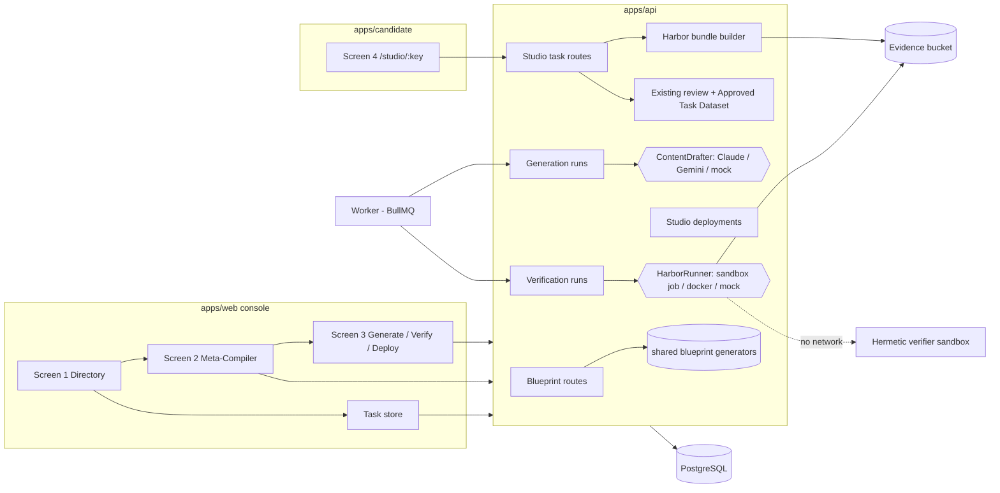

# Architecture: Templates Directory, Meta-Compiler and SME Studio

| Item | Value |
| --- | --- |
| Status | **Approved by the owner on 7 Nov 2026 (Gate 2: architecture), including AD-01 to AD-09.** No code until the plan (Gate 3) is approved. |
| Implements | [PRD-TEMPLATES-META-COMPILER](../prd/PRD-TEMPLATES-META-COMPILER.md), approved 7 Nov 2026 (decisions D1–D16) |
| Code baseline | `main` at `65ada8f` |
| Prepared by | OpenHands agent (Architect role), 7 Nov 2026 |

Design choices that need the owner's approval are marked **AD-nn** and listed in section 13. Everything else follows the PRD or existing Praxis patterns ([ARCHITECTURE.md](../ARCHITECTURE.md), [CLAUDE.md](../../CLAUDE.md)).

## 1. Principles

1. **Reuse before build.** The command layer (`runCommand`: idempotency key, audit and outbox in one transaction), route access declarations, the candidate workbench and autosave, task review, the Approved Task Dataset, GCS storage, the Vertex adapters and BullMQ stay as they are. New work plugs into them.
2. **One source of truth.** The blueprint is a JSON document on the template version (D1). Everything shown or built from it (UISpec, Meta-Prompt, pytest, `instruction.md`, `task.json`, the Harbor bundle) is generated by pure, deterministic functions in `packages/shared`.
3. **AI drafts, people decide.** Models only propose content (fields, instructions, verifier bodies, `solve.sh`). An Admin accepts it, and a Reviewer accepts tasks (NFR-03).
4. **Nothing untrusted runs in Praxis processes.** Pytest and `solve.sh` run only in a hermetic verifier sandbox with no network and no Praxis credentials (NFR-01, NFR-02).
5. **Mocks everywhere except staging and production.** Every model, runner and runtime sits behind an interface with a deterministic mock (NFR-08, NFR-08a).

## 2. System view



## 3. Data model (one Prisma migration per phase)

### 3.1 Changes to existing tables

| Table | Change | Why |
| --- | --- | --- |
| `Template` | `blueprint Json?` (validated `HarborBlueprint`, section 4); `executionMode ExecutionMode?` (`HERMETIC_MCP`, `HERMETIC_GRAPH`, `HERMETIC_SQL`); `variantOfId Uuid?` (FK to `Template`); `blueprintRevision Int @default(0)` | D1; D2 Modes; D3 Save Variant; S2-16 conflict detection |
| `Domain` | None. `ACTIVE` and `RETIRED` already exist | D15a uses `RETIRED` |

`blueprint` is nullable, so the old catalog and existing projects keep working untouched. A template without a blueprint cannot be generated or deployed.

### 3.2 New tables

All new tables have `clientId` and timestamps, and are written only through audited commands.

| Table | Key fields | Notes |
| --- | --- | --- |
| `ElicitationPreset` | `domainId`, `label`, `field Json` (a custom-field definition), `sortOrder`, `active` | Per-domain, Admin-editable presets (D7) |
| `GenerationRun` | `templateId`, `templateVersion`, `mode` (`BLUEPRINT` default, `FULL_CODE` for D5), `provider` (`claude`, `gemini`, `mock`), `model`, `promptHash`, `status` (`QUEUED`, `RUNNING`, `SUCCEEDED`, `FAILED`, `CAPPED`), `progress Json`, `estimatedCostUsd`, `actualCostUsd`, `inputTokens`, `outputTokens`, `outputRef` + sha256, `logRef`, `error` | One row per Step 1 run. Unique on (`templateId`, `promptHash`, `mode`, `model`) for idempotency (S3-03) |
| `VerificationRun` | `generationRunId`, `status`, `checks Json` (the 5 checks with result, value and evidence), `zeroBaselineScore`, `oracleScore`, `bundleRef`, `bundleSha256`, `runnerRef` (sandbox execution id), `logRef` | Measured scores with evidence (D-12). Deploy needs a succeeded run with 0.00 and 1.00 |
| `StudioDeployment` | `templateId`, `templateVersion`, `projectId`, `smeUserId`, `verificationRunId`, `studioKey` (stable slug), `status` (`ACTIVE`, `STOPPED`, `FAILED`), `runtime` (`SHARED` in Phase B, `ISOLATED` in Phase C), `stoppedAt`, `stoppedById` | Unique on (template lineage, project, SME), so `/studio/<studioKey>` survives redeploys (D14, S3-09). Generating and Verified states are derived from the runs |
| `SmeAuthoredTask` | `taskInstanceId` + `submissionVersion` (unique), `deploymentId`, `templateId`, `templateVersion`, `projectId`, `smeUserId`, `externalTaskId` (e.g. `TASK-MKTG-901`), `tptEstimate`, `executionMode`, `taskJson Json`, `bundleRef`, `bundleSha256`, `zeroBaselineScore`, `oracleScore`, `verificationEvidence Json`, `dataClassification` (`SYNTHETIC`, `REAL_PUBLIC`) | D8 = A. Linked to the existing task chain, with no copied emails. A database trigger blocks updates to `taskJson`, `bundleSha256` and `dataClassification` |

`TaskInstance`, `TaskSubmission`, `TaskReview` and `ApprovedTaskRecord` are not changed (PRD D-13).

## 4. The blueprint (`packages/shared/src/blueprint/`)

| Module | Content |
| --- | --- |
| `schema.ts` | Zod `HarborBlueprint`: `template_meta`, `harbor_contract`, `domain_meta` (Stage 1), `step_2_data_panels`, `step_3_mcp_simulators`, `step_4_invariant_catalog`, `step_5_default_rubric`, `custom_fields_by_stage`, plus `catalog` (panel 0, the existing template fields, D11b). A JSON Schema is exported for UISpec.json import and export. |
| `validate.ts` | `sectionProblems(bp)` returns problems per section. It drives the "n/6 Valid" counter in the browser and is re-run on the server (D-03): path rules (`/workspace/inputs/`, `/eval/ground_truth/`), min ≤ default ≤ max, unique ids, weights sum to 100, non-empty `inject_into`, subjects in the allowed list. |
| `generate/*.ts` | Pure functions: `uiSpec`, `metaPrompt`, `pytest` (including `test_custom_<field_id>` for each verifier-bound field, S2-09), `instructionMd`, `taskJson`, `mcpMock`. Same input gives byte-identical output (stable key order, no timestamps). |
| `studio.ts` | `studioSteps(bp)`: the 6 SME steps and their controls (S4-03 to S4-07), so the studio renders from the blueprint and nothing is hard-coded per domain. |

Content that needs domain judgement (instruction prose, verifier bodies, `solve.sh`, mock data rows) is stored in the blueprint as text the Admin accepted. The generators only assemble it. This is what makes the D5 shared studio safe and deterministic.

## 5. API (`apps/api/src/routes/`)

Every state change uses `runCommand` (Admin) or `runCandidateCommand` (SME). Every read is client-scoped. Route access is declared per route, as today.

| Route | Access | Purpose |
| --- | --- | --- |
| `GET /templates/directory` | ADMIN, PM | Screen 1 rows grouped by domain, with derived status, TPT, Modes, deployments and counts (S1-01 to S1-11). PMs get the published-only view without SME or URL fields (S1-15) |
| `GET /templates/:id/blueprint` | ADMIN; PM read-only for published | Blueprint, `blueprintRevision` and section problems |
| `PUT /templates/:id/blueprint` | ADMIN | Save a draft blueprint with `expectedRevision`; 409 `BLUEPRINT_CONFLICT` on mismatch (S2-16). Existing DRAFT-only rule applies (S2-15) |
| `POST /templates/:id/variant` | ADMIN | Save Variant: new lineage, DRAFT v1, with `variantOfId` (D3 B1) |
| `GET /templates/:id/uispec` | ADMIN | Export UISpec.json, audited (S2-11) |
| `POST /templates/:id/assistant/propose-field` | ADMIN | D7. Returns a proposal only; nothing is saved. Rate-limited and cost-capped |
| `GET`, `PUT /domains/:id/presets` | ADMIN | D7 presets |
| `POST /templates/:id/generations` | ADMIN | Step 1. Returns a run id; the worker does the work |
| `POST /generations/:id/verifications` | ADMIN | Step 2. The worker builds the test bundle and calls the runner |
| `GET /generations/:id`, `GET /verifications/:id` | ADMIN | Progress, checks and redacted logs, polled every 2 s or less (S3-08) |
| `POST /templates/:id/deployments` | ADMIN | Step 3. Needs a passing verification, a project and an assigned SME (S3-05, S3-06) |
| `POST /deployments/:id/stop` | ADMIN | Phase C (S3-10) |
| `GET /studio-tasks`, `/studio-tasks/:id`, `/studio-tasks/:id/bundle`, `/studio-tasks/export` | ADMIN | Task store (S4-11, S4-12) |
| `GET /candidate/studio/:studioKey` | Assigned SME | Studio configuration: blueprint-derived steps, task and saved state |
| `PUT /candidate/studio/:studioKey/draft` | SME | Autosave, reusing the existing revision and conflict pattern |
| `POST /candidate/studio/:studioKey/commit` | SME | Save & Commit (section 7) |
| `GET /candidate/studio/:studioKey/tasks` | SME | Own tasks only (D4) |
| `POST /test-setup/meta-compiler` | ADMIN, non-production only | D4a one-step synthetic setup; refused when `APP_ENV=production` |

## 6. Generation and verification (Screen 3)

```mermaid
sequenceDiagram
  participant A as Admin (Screen 3)
  participant API
  participant W as Worker
  participant M as ContentDrafter
  participant R as HarborRunner (sandbox)
  A->>API: POST generations (model)
  API->>API: check 6/6 valid, estimate cost, check cap and daily budget
  API-->>W: outbox event generation.requested
  W->>M: draft missing content (BLUEPRINT) or full code (FULL_CODE, switch on)
  W->>W: build studio configuration and UISpec (deterministic)
  W->>API: run succeeded, output stored in GCS
  A->>API: POST verifications
  W->>W: synthetic payload, build test bundle (deterministic tar.gz)
  W->>R: run null agent, run solve.sh, grade with pytest
  R-->>W: scores and logs (no network, no credentials)
  W->>API: checks 01-05; zero-baseline 0.00? oracle 1.00?
  A->>API: POST deployments (project, SME)
```

**ContentDrafter (AD-03).** One interface with three implementations:
- `ClaudeVertexDrafter`, using the existing `@anthropic-ai/vertex-sdk`.
- `GeminiVertexDrafter`, calling the Vertex `generateContent` REST endpoint through the existing `google-auth-library`. No new dependency.
- `MockDrafter`, deterministic, for local, demo, tests and CI.

It is used by D7 field proposals and by Step 1. Prompts treat the blueprint and SME text as data, never as instructions (the same pattern as the Support Bot). Output is schema-validated. Invalid output fails the run and is never partly applied.

**Cost control (NFR-09, D5, D6b).** Before a call, the estimated tokens times the configured model price must fit under `GENERATION_COST_CAP_USD` for the run and `GENERATION_DAILY_BUDGET_USD` for the client that day. After the call, actual usage is recorded. A run over the cap ends as `CAPPED` and nothing is applied. Live calls happen only when `APP_ENV` is `staging` or `production` and a cap is set; startup refuses a live drafter in `local`, `demo` or test (NFR-08a).

**HarborRunner (AD-04).** Interface: `run(bundleRef, mode)` where mode is `null-agent` or `oracle`, returning a score and a log.
- `SandboxJobRunner` (staging and production): a dedicated Cloud Run job, `praxis-harbor-verify`, running a pinned Python image with pytest. It has its own service account, which can only read `bundles/verify/*` and write `results/*` in the evidence bucket. It has no VPC connector and no egress, no Praxis secrets, and CPU, memory and time limits (for example 1 vCPU, 1 GiB, 120 s). The worker starts an execution with the bundle key as its argument and reads back the result object.
- `DockerRunner` (local development): the same image run with `docker run --network=none --read-only`.
- `MockRunner` (tests and CI): deterministic scores from the bundle manifest.

The null agent changes nothing; the oracle runs `solution/solve.sh`. Both are graded by `eval/test_verifiers.py`. Deploy is allowed only if the zero-baseline score is 0.00 and the oracle score is 1.00 (S3-04, S3-05).

**FULL_CODE mode (Phase C, D5 option A).** Off unless `META_COMPILER_CODEGEN_ENABLED=true`. Generated code is stored and verified the same way, and can only be served by the Phase C `ISOLATED` runtime (section 9). In Phase B it cannot be deployed.

## 7. SME studio and Save & Commit (Screen 4)

- **Route:** `apps/candidate/app/studio/[studioKey]/page.tsx`. It uses the existing candidate sign-in and the `workContext()` checks (identity, assignment, onboarding). Only the deployment's SME passes; anyone else gets 404 (S4-02).
- **Task:** on first open, the studio allocates a `TaskInstance` for the SME's `ProjectAssignment` through the existing `allocateTasks`, so staffing caps, coverage slots and review keep working. A task definition `harbor-studio-v1` is registered in `tasks/definitions.ts`; its `validateSubmission` runs the blueprint validators on the SME's answers.
- **UI:** a new `StudioWorkbench` in `apps/candidate/components/studio/` renders `studioSteps(bp)`: the 6-step sidebar, custom controls, the oracle grid annotator, curve sliders with a live SVG plot (no chart dependency) and the JSON preview. Autosave reuses `use-autosave.ts`.
- **Save & Commit (S4-10), atomic:**
  1. Build the bundle deterministically and compute its SHA-256.
  2. Upload it to `bundles/<clientId>/<sha256>.tar.gz`. The key is content-addressed, so retries are harmless.
  3. In one `runCandidateCommand` transaction: the existing `submitTask` (creates the `TaskSubmission`; the task goes to review), insert `SmeAuthoredTask` with the bundle reference, hash and `dataClassification`, plus audit and outbox.
  4. If step 3 fails, the uploaded object is left unreferenced. A nightly sweep deletes unreferenced bundle objects older than 24 hours. No partial task is ever visible.
- **Per-task verification:** after commit, the worker runs the HarborRunner on the authored bundle and records the measured scores on `SmeAuthoredTask`, as evidence for the Reviewer and for Anvil.
- **Review:** unchanged. Studio tasks appear in the existing review queue. Acceptance writes `ApprovedTaskRecord` as today, and rework returns the task to the studio (S4-13).

## 8. Harbor bundle builder (`apps/api/src/harbor/`)

- `buildBundle(bp, task)` returns the bytes, SHA-256 and manifest for the PDF §7.2 layout. It is deterministic: entries sorted, `mtime=0`, `uid/gid=0`, fixed modes, and a gzip header with no filename or time.
- It uses Node's built-in `zlib` plus a small ustar writer, so there is no new dependency (AD-05).
- `/eval/*` and `/solution/*` exist only inside the bundle. The SME's agent-facing preview and the agent workspace listing never include them (D-21, tested by path).
- Bundles leave Praxis only through Admin download and export (D16). Anvil contracts are untouched.

## 9. Phase C runtime (after 16 Nov; outline only)

A `StudioRuntime` interface with `deploy` and `stop`. The `ISOLATED` implementation runs one Cloud Run service per deployment from the generated-code image, with its own service account and no Praxis database credentials. It is reachable only through the candidate app's authenticated proxy, so `/studio/<key>` keeps working. `stop` deletes the service, so a stopped studio uses no compute (S3-10). The detailed design will come as a Phase C addendum for separate approval.

## 10. Configuration (new names; values are never committed)

| Name | Default | Purpose |
| --- | --- | --- |
| `META_COMPILER_MODELS` | Claude and Gemini model IDs on Vertex | Models offered on Screen 3 (D6). Exact IDs confirmed at deploy |
| `GENERATION_COST_CAP_USD` | Blank: live generation refused | Per-run cap (owner sets later, D5a) |
| `GENERATION_DAILY_BUDGET_USD` | Blank: live generation refused | Per-client daily budget |
| `META_COMPILER_CODEGEN_ENABLED` | `false` | D5 FULL_CODE switch |
| `REAL_DATA_ENABLED` | `false` | D5a real-public-data switch |
| `HARBOR_RUNNER` | `mock` in local and test; `job` in staging and production | Runner selection; `docker` for manual local runs |
| `HARBOR_VERIFY_JOB` | Blank | Cloud Run job name for the sandbox |

**AD-06:** the switches are environment configuration, changed by a deploy and visible in Terraform and the release history. They are not database toggles in the UI, so nobody can turn on paid generation or real data from a browser.

## 11. Seed and catalog change (D15, D15a)

- `apps/api/prisma/catalog/` holds one JSON blueprint per seeded template: the 3 mockup blueprints and the owner's template. CI validates them against the shared schema.
- `seed.ts` gains `seedCatalogV2(db, clientId)`. It idempotently upserts the domains `Digital Marketing` and `Banking` and the 15 mockup workflows. It reuses the 12 existing Banking lineages by normalised name (en dash equals hyphen). It writes blueprints for the 4 full templates and publishes them through the same `publishProblems` rules.
- A one-off job, `catalog-v2` (`src/jobs/run.ts catalog-v2`, AD-07), retires everything else: the domains `Healthcare`, `Marketing` and `Research Assistant`, and the Banking workflows not in the mockup. Drafts with no project are set to `RETIRED` by this job directly; the public retire endpoint still accepts only PUBLISHED templates. Rows used by a project keep their state. Every change is audited with actor `SYSTEM:catalog-v2`, and nothing is deleted. A dry-run mode prints the plan first.
- The console loses the New template and Add domain controls. `POST /domains` and `POST /templates` stay for the seed and tests but are not linked from the UI (S1-12, S1-13).

## 12. Front end

| App | Route | Built from |
| --- | --- | --- |
| web | `/templates` (Screen 1) | Replaces `templates/page.tsx`; new `components/templates/directory/*` |
| web | `/templates/[id]` (Screen 2) | Replaces the editor and view with `components/templates/compiler/*`: stage navigator, stage editors, custom-field dialog, inspector, assistant. Version history and publish, new version and retire actions are kept |
| web | `/templates/[id]/deploy` (Screen 3) | New `components/templates/deploy/*` |
| web | `/templates/tasks` (task store) | New |
| candidate | `/studio/[studioKey]` (Screen 4) | New `components/studio/*` |

All screens use the ADI Praxis theme from `packages/shared/theme` and existing components and Tailwind tokens (D13). Accessibility: keyboard stage navigation, a grid annotator with roving tab index, and sliders with `aria-valuetext` (NFR-10).

## 13. Architecture decisions for approval

| # | Decision | Alternative rejected |
| --- | --- | --- |
| AD-01 | Blueprint as a validated JSON column on `Template`, with a revision counter | Separate per-stage tables: more migrations and joins for a document edited as a whole |
| AD-02 | All derived artefacts generated by pure functions in `packages/shared`, used by both browser and server | Server-only generation: the inspector could not update within 1 s |
| AD-03 | Gemini through the Vertex REST API with the existing `google-auth-library`; Claude through the existing SDK; one `ContentDrafter` interface | Adding the Gemini SDK: a new dependency for one call shape |
| AD-04 | Hermetic verification in a separate Cloud Run job with its own service account, no egress and no secrets; Docker locally; mock in CI | Running pytest in the worker breaks NFR-02; an external service adds a vendor |
| AD-05 | Deterministic tar.gz written with Node `zlib` and a small ustar writer | Archive packages: harder to make byte-identical, plus a new dependency |
| AD-06 | Paid-generation, code-generation and real-data switches are environment configuration, not UI toggles | UI toggles: one compromised Admin session could enable spend or real data |
| AD-07 | Catalog change by an idempotent, audited `catalog-v2` job with a dry run | Manual SQL is unaudited; widening the retire endpoint to drafts changes a public rule |
| AD-08 | The Phase B studio runs inside the candidate app (shared runtime), isolated by sign-in, assignment and client scope. Only Phase C adds per-studio runtimes | Per-studio containers in Phase B: the infrastructure can't be ready by 16 Nov |
| AD-09 | Studio tasks reuse `TaskInstance` allocation and review; `SmeAuthoredTask` is a linked evidence table | A separate task pipeline would duplicate review and dataset logic |

## 14. Security review summary

| Threat | Control |
| --- | --- |
| Prompt injection through blueprint or SME text | Content passed as delimited data; output schema-validated; AI never saves or decides |
| Malicious `solve.sh` or verifier code | Runs only in the sandbox job: no network, no credentials, read-only inputs, time and CPU limits; results read back as data |
| Hidden ground truth leaking to the agent | Path tests on every bundle; the agent preview is built from an allow-list (`task.json`, `instruction.md`, `/workspace/inputs/*`) |
| Cross-tenant access | `clientId` on every new table and query; access tests for every new route |
| Cost abuse | Per-run and daily caps in environment configuration; rate limit on field proposals; live runs refused without a cap |
| Secrets | Keys only in Secret Manager or env; the UI shows provider and a masked suffix; logs are redacted |
| Real data | With `REAL_DATA_ENABLED=false` the classification is forced to `SYNTHETIC`; the existing synthetic-data scan runs on commit |

## 15. Testing and isolation

- **Unit (Vitest, `packages/shared`):** schema, validators, every generator (golden files) and determinism (same input gives the same bytes and SHA-256).
- **API (Vitest with real PostgreSQL):** access, tenancy, idempotency and audit for every new route; blueprint conflicts; gates (a zero-baseline other than 0.00 or an oracle other than 1.00 blocks deploy); commit atomicity (fault injected between upload and transaction); the review-to-dataset path; `catalog-v2` dry run and apply; cost-cap refusal; live mode refused outside staging and production.
- **Sandbox runner:** an integration test with the Docker runner, run on demand rather than in CI, proving that real pytest and `solve.sh` score 0.00 and 1.00 for each seeded blueprint.
- **End to end (Playwright):** Screen 1 → 2 → 3 → 4 → review → approved, using the D4a test setup and mocks. `smoke.spec.ts`, `m10.spec.ts` and `tester-profile-form.spec.ts` are updated.
- **Isolation from Anvil:** this work uses its own Docker Compose project name (`praxis-enh`), its own ports and its own test database (`praxis_enh_test`). No Anvil service, port, database, bucket or conversation is touched.

## 16. Delivery mapping

| Phase | Architecture parts |
| --- | --- |
| A (about 12 Nov) | §3.1 and `ElicitationPreset`; §4 complete; §5 directory, blueprint, variant, UISpec, presets and field proposals; §6 ContentDrafter and cost control; §11; §12 Screens 1–2 |
| B (16 Nov) | §3.2 runs, deployments and authored tasks; §5 generation, verification, deployment, studio, task store and test setup; §6 runner (sandbox job and mock); §7; §8; §12 Screen 3, studio and task store |
| C (after 16 Nov) | §6 FULL_CODE; §9; Stop studio |

## 17. Dependencies on the owner (from PRD §10d)

The production target and access (N3, N4) remain the critical path. The sandbox job (AD-04) and enabling Gemini in Vertex AI are cloud changes that need the owner's approval (N7). Nothing in this document changes `contracts/praxis/*`, `docs/integrations/PRAXIS-ANVIL.md` or any Anvil resource.
