# Praxis conversational authoring architecture — approval proposal

## Scope and ownership
Praxis owns project preparation, staffing, human task authoring, review and accepted dataset export. Anvil owns benchmark execution and assessment. The chatbot is an authoring facilitator inside Praxis. It is not a benchmark agent and cannot approve work or create payment decisions.

## System view

```mermaid
flowchart LR
 PM[PM / Admin] --> Existing[Existing Praxis project, template, policy and staffing]
 SME[Assigned SME] --> Workbench[Chat + investigation map + agent preview]
 Existing --> Workbench
 Workbench --> API[Praxis API: identity, assignment, revision and consent checks]
 API --> Memory[(Existing PostgreSQL: turns, task revisions, draft jobs)]
 API --> Context[Template + SME answers + approved rule versions + rework comments]
 Context --> LLM[Model adapter: extraction and clarification]
 LLM --> Guard[Schema, source wording, reference and policy checks]
 Guard --> Proposal[Pending proposal]
 Proposal --> Confirm[SME confirms or discards]
 Confirm --> Memory
 Memory --> Submit[Existing checks and submission]
 Submit --> Review[Existing Reviewer / Admin decision]
 Review -->|Rework| Workbench
 Review -->|Accept| Dataset[Immutable accepted dataset]
 Dataset --> Export[Contract validation and export]
 Export --> Anvil[Anvil benchmark system]
```

## Chat turn and memory
1. Author accepts versioned human-authorship terms. API checks task ownership and assignment.
2. Store the SME's answer and enqueue one durable CHAT job. Replays do not create another job.
3. Assemble current structured case, previous answers, template schema, unresolved issues, published project policy and actual rework comments. Explicit size limits fail visibly rather than silently forgetting.
4. The model proposes extraction into allowed sections and rule links. Substantive additions must be grounded in SME-authored text. Free model replies are replaced by server-owned task guidance.
5. Check schema, sensitive patterns, known evidence/rule/step IDs, contradictions detectable by deterministic rules, scoring and human boundaries. Unsupported proposals cannot be applied.
6. Show a pending coordinated change. The SME confirms or discards it. Revision or policy changes invalidate stale proposals.
7. The map reads confirmed steps and dependencies. It is an authoring model, not evidence of executed tools. View as agent uses a server allowlist; reference solution and rubric remain private.
8. Final revision requires authorship declaration, reconciliation and existing submit checks. A human makes acceptance/rework decisions.

Memory is project/task scoped persisted application state. Chat history is not model training. Current implementation supplies bounded context directly; a permission-filtered vector retrieval system and reviewed history summaries remain future work.

## Project policy boundary
Existing PM/Admin policy upload, extraction, rule review and publication are reused. Retrieval uses approved rule versions and source references. A document's extraction is not proof that it is an authentic policy. SME source upload is not automatic policy publication. A candidate-to-project policy proposal/review bridge is a flagged dependency.

## Single and multi-agent views
One workbench shell: conversation, examples, policy sources, graph inspector, validation and agent preview. A single agent has investigation steps and dependencies. Multi-agent design groups steps by role and adds handoff artifacts, permissions, parallel joins and stage/final grading. Multiple independent cases are separate single-agent trials.

The multi-agent graph is a design preview. Native orchestration, per-role execution isolation and executable multi-agent export require separate implementation and tests. Do not infer these capabilities from a graph.

## Trust and reliability controls
- Human-only substantive authoring, versioned consent and revision-bound declarations.
- Read-only section examples; no generate-answer or insert-example action.
- Paste/cut/text-drop prevention in authoring inputs. Upload controls remain available. This is friction, not proof against external authorship.
- Exact-source extraction controls; known-reference checks and deterministic KYC checks. These cannot establish complete semantic truth.
- Existing similarity checks produce review signals, not an automatic accusation, rejection or payment hold. No reliable universal AI-authorship detector is claimed.
- Model output cannot change roles, approvals, project policies, payment or reviewer provenance.
- Model call outside transaction, claim-once jobs, no automatic uncertain paid-call retry; explicit failure preserves draft.
- Existing acceptance, hash-chain dataset and payment eligibility rules remain authoritative.

## Current providers and deployment boundary
Existing Vertex Claude adapter plus explicit controlled mock are available. No live provider call was used for local validation. OpenAI adapter, production model evaluation, large-library retrieval and model training are future acceptance items. No deployment, remote push, paid model call or live payment is approved by approving this mockup.

## Revision 1.3 - Classic / Chatbot / Both
The project stores a versioned authoring-experience configuration; the template separately stores agent mode. The API resolves the assigned configuration and gates allowed editing entry points. A shared task-draft service feeds Classic fields and the conversational facilitator; both use the same revision/validation/submit pipeline. Map and agent preview project the same data. Chat proposals require confirmation and become stale after conflicting field edits. CLASSIC does not dispatch facilitation calls; CHATBOT restricts alternate-editor bypass; BOTH allows view switching without separate task copies. The instruction and agent-preview affordances remain common. See AUTHORING-EXPERIENCE.md for migration, parity and acceptance requirements. This layer remains a specification gap in current code.

## Revision 1.4 local implementation status
The project-mode layer described in revision 1.3 is now implemented locally. Classic PUT and chat mutation endpoints enforce the configured view; a locked metadata route persists the permitted view and unsent answer. The two editors share TaskInstance.output and optimistic revision checks. The switch barrier flushes existing autosave before reloading. Consent/declaration, policy reconciliation, checks and submit remain shared; no second task or benchmark contract is created. NULL legacy projects are preserved and active configuration migration remains excluded. See IMPLEMENTATION-EXPERIENCE-HANDOFF.md for scope and remaining gaps.
