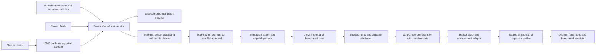

# 17 Multi-agent authoring and benchmarking - approved implementation scope

Status: Owner approved starting implementation on 10 November 2026, America/Chicago, after reviewing the architecture. Consolidated in specification v2.1. Extends chapters 02, 05, 08 and 12. Approval to build is not evidence that features are implemented, qualified or deployed. The first local Anvil viewer checkpoint is recorded in chapter 18.

## 1. Approved architecture direction

Build a shared, versioned workflow definition authored in Praxis and executed by an Anvil-owned LangGraph runner through a qualified Harbor adapter. Use LangChain for model/tool interfaces where appropriate; LangGraph controls explicit state transitions, concurrency and human interruption. Harbor supplies the benchmark environment lifecycle, actor execution/artifact collection and separate verification. None of these libraries supplies application permissions or task approval automatically.

First release scope: single-agent and fixed-role multi-agent graphs; sequential and parallel paths; typed decisions, joins, bounded correction loops; explicit business human response contracts. All templates use the same engine with template-specific schemas and adapters. Enable executable export per qualified template, rather than claiming every template is ready when the graph renderer works.

Excluded: autonomous agent recruitment, SME-versus-LLM task authorship, two-SME adjudication, model training, new cloud provisioning, paid execution and deployment. These need separate decisions. Existing installation, access and release controls continue to apply.

## 2. Four distinct concepts

| Concept | Owner | Meaning |
|---|---|---|
| Authoring experience | PM/Admin project setting | Classic, Chatbot or Both; one canonical task and the same controls. |
| Agent mode | Published template | Single or Multi; fixed before SME assignment, read-only in author/reviewer screens. |
| Platform review | Praxis | SME authoring, optional Expert review, final PM approval; same person may hold the last two responsibilities with separate audit events. |
| Business human node | Authored task | A person inside the case process, such as a case lead asked to resolve an exception; never a substitute for platform approval. |

Three top-level task states remain Authoring, Review/Approval Pending and Approved. Pending carries an internal stage: Expert Review or PM Approval. Return for correction moves the same task back to Authoring with comments and revision history. The direct SME -> PM route is the demo default; the SME -> Expert -> PM route is supported only after its permissions and stage engine are implemented.

## 3. System architecture

Praxis stores authored intent, reference answers and approval evidence. Anvil stores attempts, checkpoints, model/tool calls, human runtime responses, artifact hashes and grading receipts. Do not place provider credentials or private reference solutions in graph nodes. A submitted graph is declarative data, never executable JavaScript/Python, a shell command or a dynamic import path.

The authoring facilitator may use an independent bounded graph for context/reconciliation, but it must not invoke benchmark agents to compose SME answers. Checkpoints for the facilitator, benchmark trial and platform review are separate namespaces with separate permissions and retention.

## 4. Screen and field specification

Existing header retains task title, template, read-only agent mode, three-state status, step count, saved/saving/failed indicator and template/role-specific instruction PDF.

Classic displays editable schema-driven fields for every applicable section. Chatbot displays the same section progress, task-scoped conversation, typed answer composer, source-aware clarification and a proposed-change confirmation. Both saves to the same output and revision; view switches await save and preserve unsent chat text. No answer-generation button is introduced.

The connected Flow Preview remains below both editors. Main path runs horizontally; diamonds show decisions, human nodes are visually distinct, branch labels remain readable, correction loops route above/below the main path. Selected nodes open their fields above. Fit, zoom and accessible list controls are proposed for large graphs; a small-screen list preserves semantics without shrinking text. Preview is a projection of stored graph data, not a second editable source.

| Field group | SME supplies | Help and validation |
|---|---|---|
| Role | Name, responsibility, allowed tools and evidence | Explain what this role can see and produce. Resolve tools against approved template capabilities. |
| Agent step | Instruction, input references, output artifact/schema | Describe observable work and expected handoff. No hidden answer or rubric in actor instruction. |
| Decision | Question, typed result field, conditions, default/unknown/error route | Each outcome has an explicit destination; no prose evaluated as code. |
| Join | Required predecessor outputs and optional inputs | Continue only when the declared branch-aware inputs exist; no last-writer-wins merging. |
| Human step | Business actor role, response schema, permitted evidence, timeout route | Explain who responds, what is shown and what happens if no response arrives. |
| Loop | Return transition, condition, maximum iterations, exhausted destination | Limit is authored/configured, not globally fixed at two. Exhaustion must stop or escalate. |
| Terminal | Required deliverable and completion condition | A cancelled, unknown or incomplete attempt is not successful completion. |
| Policy/rubric links | Approved rule versions and criterion IDs | References must resolve and remain separate from actor-visible content. |

Reviewer uses the same graph beneath the task fields, with version diff, policy-source panel, validation findings and comments linked to nodes/fields. Expert may edit with recorded reason or return for correction. Material edits create a new revision and require the relevant checks and author confirmation/reauthoring as applicable. PM approves the exact checked revision, or returns it. Neither can change template agent mode in this screen.

PDF instructions for each template and author/reviewer role must explain every displayed field, expected input, one relevant example, common errors, graph navigation, confirmation/save states and submission/rework steps. Examples teach the field structure; they must not supply the answer to the assigned case. Keep examples collapsed and separate from task facts.

## 5. Versioned graph and export contract

Proposed name: WorkflowGraph v1 inside canonical task output. Final wire schema identifier must be allocated jointly with Anvil: current Anvil already recognises praxis.anvil.task.v1, v2 and v3; do not reuse any of these identifiers for incompatible graph semantics.

Graph contains pinned template/policy versions; stable role/node/edge IDs; input, agent_step, decision, join, human_step, output and escalation nodes; declared schemas and visibility; typed branch predicates; loop definitions; terminal requirements; policy and rubric references. Global node/edge/call/time/token/cost bounds are part of the execution plan. Layout coordinates are presentation metadata and do not change semantics.

Validate structural uniqueness, endpoint/reference resolution, reachability, branch determinism, unknown/error coverage, branch-aware joins, artifact compatibility and terminal accessibility. Reject undeclared cycles. Every cycle must correspond to an explicit bounded loop with a reachable exhausted exit; enforce a separate global transition cap as defense in depth. Validate nested loops and overlapping cycles, not only a single back edge.

Separate actor projection from sealed verifier material before packaging. Actor projection contains allowed evidence, tools, role instructions and declared handoffs only. Private references, rubric answer keys, source review discussion and future evidence remain excluded until an authorised reveal. Projection is server-enforced for API, downloads, logs and runtime adapters, not merely hidden in the UI.

Export readiness is distinct from authoring completion, task approval and benchmark qualification. Unsupported human, tool or graph semantics produce explicit blocking diagnostics. Preserve legacy contracts and exports unchanged; no automatic graph inference or silent migration from existing dependsOn DAGs. Old task envelopes remain readable.

## 6. LangChain/LangGraph execution

Compile validated declarative graphs using an allowlisted node factory. Use existing Anvil Python orchestration/persistence where possible; do not add a second production JS execution service solely because Praxis uses TypeScript. Shared JSON contract and cross-language fixtures prevent drift. Exact installed versions and supported APIs must be checked before implementation; website examples may exceed the installed Harbor/runtime version.

A trial is an agent system executing one task in one environment for one repetition. Parallel specialist roles are nodes within that trial. A benchmark comparison across three systems creates three trials, not an accidental cross-product of every role with every model.

Persist trial identity, graph hash, task revision, policy snapshot, runtime version, active nodes, iteration counts, per-role artifacts and outstanding human requests. Use durable PostgreSQL checkpoints and a durable call/effect ledger. Queue dispatch commits before external work. Transaction boundaries surround state changes, not long model requests.

Parallel nodes write separate namespaced outputs. A join validates the required set then constructs an explicit merged input. Decision nodes use typed predicates over captured artifacts; when domain judgement requires a model, its bounded structured output is an input to the predicate and is graded as agent behavior. The runner must not read the reference answer to choose a branch.

Resume only the same authorised trial/checkpoint and immutable graph snapshot. Recheck cancellation, permissions, policy rights, expiry and remaining budget before each external call and human resume. Changes to an authored task create a new trial; never silently resume against different task content.

Replay may re-enter node code. Isolate effects behind durable idempotency keys (trial/node/iteration/call index). Reserve budget before dispatch; record response/usage/artifact hashes before advancing. A timeout after dispatch is Unknown until reconciled; no automatic paid resend. A linked fresh retry is explicit and preserves the prior uncertain evidence. Do not claim exactly-once execution from checkpoints alone.

## 7. Human interaction policy

Two explicitly labelled modes:

1. Scripted response fixture: deterministic, preapproved response set exposed through an allowlisted broker based on the current request. Not an actual human and not a model-generated substitute. Private rubric remains unavailable to the actor.
2. Actual business human: authenticated assigned responder sees only permitted request/evidence, submits a schema-validated signed/audited response for the exact request and checkpoint. LangGraph interrupt/resume provides the pause boundary; application authorisation remains mandatory.

Recommended MVP: fixture mode for automated repeatable tests; author and reviewer screens fully describe human nodes, while actual-human benchmark execution remains blocked until secure request/resume and custody tests pass. A fixture result must always show Scripted human response in receipts. Do not mix fixture and actual-human runs in one undifferentiated comparison.

Long human waits must not keep an unbounded paid container running. Proposed pause path seals outputs, releases the runtime and recreates a qualified environment from a supported snapshot on resume. If an environment cannot be restored exactly, mark actual-human execution unsupported rather than improvising recovery. Define wall-clock and billable-runtime limits separately.

## 8. Harbor adapter and verifier

Use the existing Anvil Harbor dispatch/admission and evidence collection interfaces. Select installed-agent versus host-orchestrated adapter based on demonstrated compatibility and isolation. Preferred containment target is the graph executor inside an isolated actor runtime with scoped broker access. If orchestration remains host-mediated, label that boundary accurately; do not claim native service containment from container presence.

Harbor receives the public task package and agent adapter. Provider access is through the existing guarded broker and approved model mapping, not unrestricted environment keys. Each role has a per-call identity and allowlisted tools; only declared handoffs cross role boundaries. Role-level process isolation is a separate capability, not assumed from logical role names.

Separate verifier receives sealed collected artifacts and protected rubric/reference material after actor completion. It validates required artifacts, decisions, tool evidence, prohibited actions, handoffs and loop behavior. Model-generated claims alone do not establish successful tool execution. Preserve the existing Task scoring and weights. Harbor native reward is retained as a separate execution metric, never substituted for the Task score.

An oracle/known-good run and an empty or deliberately invalid baseline test the verifier. These are necessary checks but do not prove scoring calibration; Expert review and adversarial cases remain required. Validation must exercise actual installed Harbor, artifact collection and separate verifier custody before qualification is advertised.

## 9. Chatbot, policies and guardrails

Retain all handover controls: task-only scope, no answer generation, typed SME authorship, consent and revision-bound declarations, optional paste friction, plagiarism/similarity findings for human review and no claim that external LLM use can be reliably detected.

Chat may place exact supplied content into a proposed field patch, identify contradictions, ask for missing evidence and explain field meaning. It cannot invent role instructions, business conclusions, tool results or reference rubric judgements on behalf of the SME. A change such as missing SSN/TIN triggers affected-field checks across evidence, steps, decision conditions and rubric; substantive replacements remain pending SME confirmation.

Retrieve only permission-filtered approved policy versions for the current tenant/project/task. Preserve document hashes, original files, extraction spans/page locators and reviewer decisions. SME-uploaded policy is a pending proposal until reviewed; document instructions never override system/tool permissions. Contradictory, superseded or missing sources trigger an unresolved finding, not a guessed rule.

Validate provider output against strict schemas, source spans and allowed paths. Reject invented IDs/citations, additional fields, cross-role evidence, hidden-answer requests and instruction injection. Reconcile proposed changes against the current revision atomically. Generic model safety filters supplement these checks; they are not proof against hallucination.

## 10. Changes to existing functionality

| Existing area | Proposed change | Compatibility/regression requirement |
|---|---|---|
| Task output | Optional versioned workflow graph and bindings | Preserve unknown legacy fields; no rewrite/backfill without reviewed migration. |
| Template registry | Graph capabilities, role schemas, visibility and help | Both editors use the same registry; unsupported templates explicitly blocked. |
| Classic/Chatbot | Node fields, graph projection and affected-field proposals | Existing save barriers, declarations, mode enforcement and draft retention stay common. |
| Review | Graph/policy diff and two pending sub-stages | Exact revision approval; existing direct route retained; authority explicit. |
| Policy intake | Node/rule bindings and SME proposal review | Reuse original/version/rule services; never auto-publish from upload/chat. |
| Export/import | New capability-negotiated graph adapter | v1/v2/v3 continue; unsupported contract returns a blocker. |
| Benchmark runtime | LangGraph graph compiler, role state and human requests | Reuse Anvil durable dispatch, budgets, cancellation and Unknown handling. |
| Harbor | Graph-aware actor and sealed verifier integration | Existing actor/verifier trust boundary and original score preserved. |
| Results | Per-role/branch/loop/human timeline and usage | Preserve seven existing views; no absent score rendered as zero. |
| Payments | No new earning for nodes, views or rework | Same accepted task is one payable unit under existing eligibility rules. |

Proposed new persistence: graph revision/hash attached to task revision; runtime node/transition/artifact records attached to Anvil attempts; human request/response events; compatibility/qualification receipts. Determine which existing tables can store these before adding migrations. Cross-service IDs and receipts are immutable references, not shared database writes.

## 11. Journeys

PM: create project -> choose published template with fixed agent mode -> select Classic/Chatbot/Both -> policies/review route/task target/end date -> eligible SME assignment. No benchmark model selection is required for an SME to author a task.

SME: open instructions -> fill sections or answer facilitator -> author roles/steps/branches/human/loops -> inspect horizontal graph -> reconcile dependencies -> check -> declare own work -> submit. Failed save retains the text and current section. Rework returns to the same task with exact comments and diff.

Expert: inspect assigned submission and policy sources -> check reference, rubric and graph -> edit with reason or return -> submit reviewed exact revision to PM. PM performs final approval; if Expert and PM are the same person, responsibility and decision events remain visible.

Benchmark operator: import approved immutable package -> inspect compatibility -> select system/model mapping, qualified environment and repetitions -> inspect cost upper bound -> authorised dispatch -> inspect role/branch/human trace -> original Task results and separate native reward -> export receipts. Actual model calls need explicit separate authority.

## 12. Acceptance and rollout

| Gate | Evidence required before passing |
|---|---|
| Contract | Shared TS/Python positive and negative fixtures; version negotiation; no legacy drift. |
| Graph | Sequential, parallel, conditional, unknown/error, join and bounded-loop cases; reject unbounded/nested-invalid cycles and unreachable terminals. |
| Persistence | Restart mid-node, before/after dispatch and during human wait; no duplicate effects; retained Unknown evidence; cancellation and expiry checked. |
| Visibility | Guessed IDs, cross-tenant requests, wrong-role artifacts, future evidence and private rubric extraction rejected across APIs/packages/logs. |
| UI | Every supported template/section; last keystroke survives tab, view and reload; shared graph/data; readable horizontal graph and accessible list. |
| Chat | Missing SSN/TIN correction, conflicting policy, generation requests, multilingual scope bypass and malicious document instructions; no unsupported substantive patch. |
| Review | Direct and Expert->PM routes; same-person audit; stale approval invalidation; rework/payment invariants. |
| Harbor | Actual installed runtime, actor/tool interaction, artifact sealing and separate verifier; oracle, invalid baseline and tamper cases. |
| Scoring | Captured evidence drives original rubric; missing/Unknown distinct from zero; no reward substitution or answer-key leak. |
| End to end | Approved Praxis revision -> qualified Anvil import -> bounded run -> sealed verification -> stored results/export with hashes and receipts. |

Rollout: approval -> schema/capability foundation -> shared authoring graph -> offline graph runner -> review/export integration -> installed Harbor qualification -> separately authorised live-model pilot -> staging acceptance -> separate release approval. No phase is complete from a mockup alone.

## 13. Implementation baseline and remaining qualification

A. Anvil Python LangGraph is the benchmark execution owner; Praxis authors a shared declarative contract.
B. Template owns agent mode; PM chooses authoring experience and one of the two review routes.
C. Fixed declared roles first; same model across roles as the initial comparison policy, optional explicit mixed-model system plans later.
D. Scripted business-human fixtures first for automated benchmarking; actual-human execution gated on restore/resume qualification.
E. Template-by-template execution qualification; preserve original scores, legacy contracts and pay-per-accepted-task behavior.
F. Local implementation is authorised. Paid model calls, new cloud provisioning and deployment are not authorised by that decision. Pin and review dependencies before installation; maintain existing access and release controls.

## 14. Sources and handover

Inspected local Praxis commit 3c191e9 and current Anvil checkout a8a1a42. Relevant code: packages/shared/src/praxis-contract.ts; apps/api/src/harbor/{bundle,runner}.ts; Anvil services/backend/src/anvil/{praxis_contract,praxis_staged,praxis_executable,environment_structured_agent,harbor_agents}.py and services/backend/pyproject.toml. Inspection is not full runtime qualification.

Official references checked for design, not installed-version acceptance:
- LangGraph persistence: https://docs.langchain.com/oss/python/langgraph/persistence
- LangGraph interrupts and replay cautions: https://docs.langchain.com/oss/python/langgraph/interrupts
- Harbor custom agents: https://docs.harborframework.com/agents/custom-agents
- Harbor separate verifier: https://docs.harborframework.com/tasks/separate-verifier

Continuation: the owner subsequently approved proceeding with the architecture and requested local implementation and candid validation. Anvil commit d7c2536 implements the first read-only ordered-stage viewer and single-SVG export; the full graph contract, multi-agent runtime and Praxis integration remain unfinished. Do not use OpenHands for this work. Keep this specification and the continuation register current after material decisions. The historical filename contains APPROVAL-DRAFT for link compatibility; its status is superseded by this section and chapter 18.
