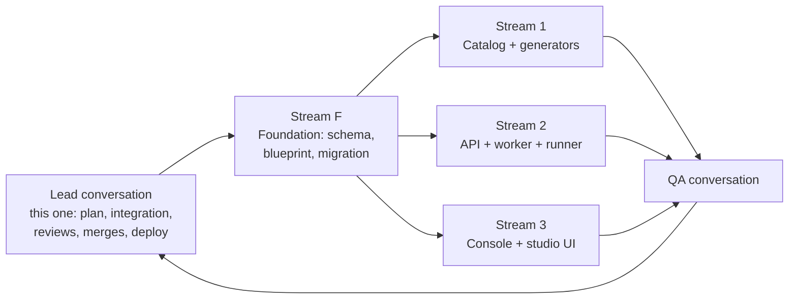

# Build plan: Templates Directory, Meta-Compiler and SME Studio

| Item | Value |
| --- | --- |
| Status | **Approved by the owner on 7 Nov 2026 (Gate 3: plan).** Coding started 7 Nov. |
| Implements | [PRD](../prd/PRD-TEMPLATES-META-COMPILER.md) (approved 7 Nov) and [architecture](../architecture/ARCH-TEMPLATES-META-COMPILER.md) (approved 7 Nov) |
| Target | Phases A and B in production by **16 Nov 2026**; Phase C after, with separate approval |
| OpenHands budget | **$600** cap for Phases A + B (owner, 7 Nov). Alerts at $300 and $480; stop at $600 unless raised |
| Prepared by | OpenHands agent (Planner role), 7 Nov 2026 |

## 1. How the work is organised

- **Foundation first (lead, 7–8 Nov).** The lead conversation lands the shared contracts that all streams depend on: Prisma schema and migration, the `HarborBlueprint` Zod schema, validator signatures and API request/response types. Freezing these first stops the streams from conflicting.
- **Three coding streams in parallel (9–12 Nov),** each its own OpenHands conversation, branch and local resources (section 6). Each stream owns separate folders, so merges rarely conflict.
- **One QA conversation (12–14 Nov)** that did not write the code. It tests against the PRD acceptance criteria and reports defects to the lead.
- **The lead** reviews and merges every PR into an integration branch, keeps the daily status, and runs the release.

Every PR is small, has tests and passes CI before merge. No PR goes to `main` until the integration branch is green and QA has passed.

## 2. Branches

| Branch | Purpose |
| --- | --- |
| `feat/mc-integration` | Integration branch, from `main`. All stream PRs target it. Merged to `main` by one PR after QA |
| `feat/mc-foundation` | Stream F |
| `feat/mc-catalog` | Stream 1 |
| `feat/mc-api` | Stream 2 |
| `feat/mc-ui` | Stream 3 |
| `fix/mc-*` | QA defect fixes |

`main` stays releasable throughout. The docs PRs (#8 PRD, #9 architecture, this plan) are merged to `main` before coding starts.

## 3. Work breakdown

IDs: **F** = foundation, **C** = catalog and generators, **A** = API and worker, **U** = UI, **Q** = QA, **R** = release. Each task lists the PRD requirements it closes.

### Stream F: foundation (lead, 7–8 Nov)

| ID | Task | Requirements | Done when |
| --- | --- | --- | --- |
| F1 | Prisma migration: `Template.blueprint`, `executionMode`, `variantOfId`, `blueprintRevision`; new tables `ElicitationPreset`, `GenerationRun`, `VerificationRun`, `StudioDeployment`, `SmeAuthoredTask`; immutability trigger on `SmeAuthoredTask` | D-01, D-11, D-13, D-14 | Migration applies and rolls forward on an empty and a seeded DB; additive only (no drops or renames) |
| F2 | `packages/shared/blueprint/schema.ts` and JSON Schema export | D-01, D-02 | Round-trip tests; the PDF §8 example validates |
| F3 | `validate.ts` with `sectionProblems` (rules only; messages final) | D-03, S2-03 | Tests per rule |
| F4 | Shared API types (Zod) for every route in architecture §5 | NFR-06, NFR-07 | Typecheck passes in all apps |
| F5 | Config additions (architecture §10) with startup refusals for live AI outside staging/production and missing caps | NFR-08, NFR-08a, NFR-09 | Config tests |

### Stream 1: catalog and generators (9–11 Nov)

| ID | Task | Requirements | Done when |
| --- | --- | --- | --- |
| C1 | Generators: `uiSpec`, `metaPrompt`, `pytest` (incl. `test_custom_<field_id>`), `instructionMd`, `taskJson`, `mcpMock` | S2-08, S2-09, S2-10 | Golden-file tests; byte-identical on re-run |
| C2 | `studioSteps(bp)` for the 6 SME steps | S4-03 to S4-07 | Unit tests for each control type |
| C3 | Deterministic bundle builder (`zlib` + ustar), hidden-path allow-list | D-20, D-21 | Same input gives same SHA-256; no `/eval` or `/solution` in agent views |
| C4 | Blueprints: Launch of Noise Cancelling Phone, KYB and beneficial ownership, AML transaction-monitoring alerts (agent drafts, synthetic) | S1-17 | 6/6 valid; Docker runner scores 0.00 / 1.00; **owner review by 11 Nov (N9)** |
| C5 | Owner's template blueprint from the spec | S1-17 | Same as C4; **needs the spec by 9 Nov (N8)** |
| C6 | `seedCatalogV2` and the `catalog-v2` job with dry run | S1-16, D15, D15a | Idempotent; dry-run plan matches the PRD; nothing deleted; running projects unaffected |

### Stream 2: API, worker and runner (9–12 Nov)

| ID | Task | Requirements | Done when |
| --- | --- | --- | --- |
| A1 | Directory route (Admin and PM views) | S1-01 to S1-11, S1-15 | RBAC tests; PM sees no drafts, emails or URLs |
| A2 | Blueprint read/save with revision conflict; Save Variant; UISpec export | S2-11, S2-12, S2-15, S2-16 | Conflict returns 409; variant label unique per domain |
| A3 | Presets and `propose-field` (proposal only) | S2-05 to S2-07, D7 | Mock drafter tests; nothing saved by the proposal |
| A4 | `ContentDrafter`: Claude Vertex, Gemini Vertex REST, mock; cost estimate, per-run cap, daily budget | D6, D6b, NFR-09 | Tests with mocks only; live calls refused without cap and outside staging/production |
| A5 | Generation runs (worker, outbox, progress, idempotency) | S3-01 to S3-03, S3-08, NFR-13 | Repeat request returns the same run |
| A6 | `HarborRunner`: mock, Docker, Cloud Run job; verification runs with checks 01–05 and stored evidence | S3-04, S3-05, D-12 | Deploy blocked unless 0.00 / 1.00; evidence stored |
| A7 | Deployments with stable `studioKey` | S3-06, S3-07, S3-09, D14 | URL unchanged after redeploy |
| A8 | Candidate studio routes: config, autosave, atomic commit, own tasks | S4-01, S4-02, S4-10, S4-13, D-10 | Fault-injection test proves no partial task; other SMEs get 404 |
| A9 | Per-task verification after commit; task store routes and streaming export | S4-11, S4-12, D-12 | Admin-only; audited export |
| A10 | Non-production test setup route | S4-14, D4a | Refused in production; idempotent |
| A11 | Nightly sweep for unreferenced bundle objects | D-22 | Test with fake GCS |

### Stream 3: console and studio UI (9–12 Nov)

Stream 3 builds against the shared types from F4 and mocked API responses until Stream 2's routes land.

| ID | Task | Requirements | Done when |
| --- | --- | --- | --- |
| U1 | Screen 1 directory (Admin and PM), header shortcut; remove New template and Add domain | S1-01 to S1-15 | Matches mockup layout in ADI Praxis theme |
| U2 | Screen 2 Meta-Compiler: stage nav (panel 0 + 5 stages), stage editors, custom-field dialog, AI proposal Accept / Edit / Discard, inspector (UISpec, Meta-Prompt, pytest), n/6 Valid, Save Variant, version actions | S2-01 to S2-18 | Inspector updates < 1 s; keyboard navigable |
| U3 | Screen 3 Generate, Verify, Deploy with progress, checks, logs, model selector, cost estimate | S3-01 to S3-09 | Deploy disabled until checks pass |
| U4 | Task store page | S4-11, S4-12, S1-14 | Inspect JSON and download bundle |
| U5 | Candidate `/studio/[studioKey]`: 6 steps, grid annotator, curve sliders with SVG plot, JSON preview, DB metadata panel, Save & Commit | S4-01 to S4-10 | Preview equals stored JSON; works on 1280 px and up |
| U6 | Accessibility pass | NFR-10 | Axe check clean on all 4 screens |

### QA (12–14 Nov)

| ID | Task |
| --- | --- |
| Q1 | Run every PRD acceptance criterion; record pass/fail with evidence in `docs/testing/` |
| Q2 | Playwright journey Screen 1 → 2 → 3 → 4 → review → approved, with mocks; update `smoke`, `m10`, `tester-profile-form` specs |
| Q3 | Security checks: RBAC per route, tenancy, hidden paths, prompt-injection fixtures, live-call refusal |
| Q4 | Performance checks for NFR-12 on seeded data (500 templates) |
| Q5 | Sandbox runner test with Docker for each seeded blueprint |
| Q6 | Human QA by the owner in a non-production environment (N12) |

### Release (13–16 Nov)

| ID | Task | Needs |
| --- | --- | --- |
| R1 | Fix or replace the staging deploy path (currently fails at startup, no GitHub environments) | N3, N4 |
| R2 | Terraform for the `praxis-harbor-verify` job, its service account and bucket permissions; enable Gemini in Vertex AI | N7 |
| R3 | Deploy to staging; run `catalog-v2` dry run, then apply; smoke test | R1, R2 |
| R4 | Owner QA on staging (Q6) | N12 |
| R5 | Production release: `v*` tag runs `release.yml` (migrate job, 10% canary, then 100%) | N13 approval |
| R6 | Production `catalog-v2` dry run, then apply; create projects, SMEs, Reviewers and deployments from the owner's list | N10 |
| R7 | Production smoke test with one test SME task through review | — |

## 4. Schedule

| Date | Lead | Stream 1 | Stream 2 | Stream 3 | QA | Owner |
| --- | --- | --- | --- | --- | --- | --- |
| Sat 7 Nov | Merge docs PRs; F1–F5 | — | — | — | — | Architecture and plan approved (done); production target (N3) |
| Sun 8 Nov | Finish F1–F5; open stream conversations | — | — | — | — | Production target (N3) if not given 7 Nov |
| Mon 9 Nov | Reviews, merges; R1 | C1, C2 | A1, A2 | U1 | — | Production access (N4); template spec (N8) |
| Tue 10 Nov | Reviews; R2 | C3, C4 | A3, A4, A5 | U2 | — | Cloud changes (N7) |
| Wed 11 Nov | Reviews; staging deploy of Phase A | C5, C6 | A6, A7 | U2, U3 | Starts on Phase A | Review blueprints (N9) |
| Thu 12 Nov | Integration; staging deploy | Fixes | A8–A11 | U4, U5 | Q1–Q3 | SME and Reviewer list (N10); cost cap (N11) |
| Fri 13 Nov | Defect triage; R3 | Fixes | Fixes | U6, fixes | Q2–Q5 | Owner QA starts (Q6) |
| Sat 14 Nov | Merge to `main`; production approval request | — | — | — | Retest | QA sign-off; production approval (N13) |
| Sun 15 Nov | R5, R6, R7 | — | — | — | Production smoke | — |
| Mon 16 Nov | Support | — | — | — | — | SMEs start |

Stream conversations close when their work is merged, to save budget.

## 5. Definition of done (every task)

- Code, tests for each acceptance criterion it closes, and passing CI (typecheck, unit, API, E2E where relevant).
- State changes use the command layer: idempotency key, audit and outbox.
- Every query is client-scoped; every new route declares its access and has an RBAC test.
- No live provider calls in tests or CI; no secrets in code.
- No changes to `contracts/praxis/*`, `docs/integrations/PRAXIS-ANVIL.md` or any Anvil resource.
- Docs updated where behaviour changes (`docs/MODULE-GUIDE.md`, user guide).

## 6. Isolation between streams and from Anvil

| Resource | Lead | Stream 1 | Stream 2 | Stream 3 | QA |
| --- | --- | --- | --- | --- | --- |
| Checkout | `/workspace/praxis-enhancements` | own sandbox `/workspace/praxis-mc-catalog` | own sandbox `/workspace/praxis-mc-api` | own sandbox `/workspace/praxis-mc-ui` | own sandbox `/workspace/praxis-mc-qa` |
| Compose project | `praxis-enh` | `praxis-mc1` | `praxis-mc2` | `praxis-mc3` | `praxis-mcq` |
| Port offset (PG / Redis / API / web / candidate) | +0 | +10 | +20 | +30 | +40 |
| Test database | `praxis_enh_test` | `praxis_mc1_test` | `praxis_mc2_test` | `praxis_mc3_test` | `praxis_mcq_test` |

Each conversation runs in its own OpenHands sandbox. None of them uses `/workspace/anvil-prd-validation`, any Anvil service, port, database, bucket or conversation. Live paid model calls are never made by any conversation; only the deployed staging/production apps make them, within the owner's cap.

## 7. Budget control

| Conversation | Cap |
| --- | --- |
| Lead (this conversation, from now) | $60 |
| Stream 1 | $100 |
| Stream 2 | $120 |
| Stream 3 | $130 |
| QA | $60 |
| Contingency (lead decides, reported to owner) | $130 |
| **Total** | **$600** |

Each stream gets its cap and stops at it, reporting where it got to. The lead reports total spend daily and alerts the owner at $300 and $480.

## 8. Risks and responses

| Risk | Response |
| --- | --- |
| Production target or access late (N3, N4) | Biggest risk. If not resolved by 9 Nov, report the same day with options (for example, launch in staging with real sign-in) |
| Owner's template spec late (N8) | Ship the 3 mockup blueprints on 16 Nov; add the owner's template within 2 days after |
| A stream falls behind | Lead moves tasks between streams; Phase B UI polish moves before backend features are cut |
| Sandbox job not ready (R2) | Do not deploy studios without measured 0.00 / 1.00; report the same day |
| Merge conflicts between streams | Foundation contracts frozen on 8 Nov (end of day); folder ownership per stream; daily integration |
| Budget exceeded | Stop at $600 and report; no work beyond the cap without approval |

## 9. Rollback

- Migrations are additive only, so the previous app revision runs on the new schema.
- `release.yml` shifts traffic 10% then 100%; rollback is `gcloud run services update-traffic` to the previous revision for each service.
- `catalog-v2` records every change in the audit log with the previous status, and has a reverse mode that restores those statuses.
- Studios can be disabled by removing deployments (Phase B) without affecting existing projects or tasks.

## 10. Approval

Approved by the owner on 7 Nov 2026, after the architecture approval the same day.
